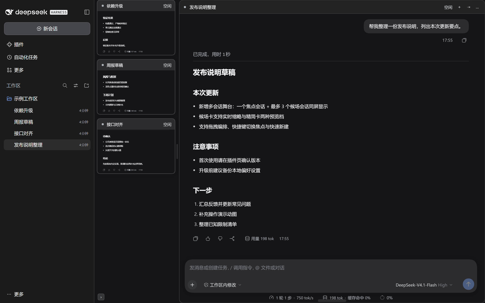
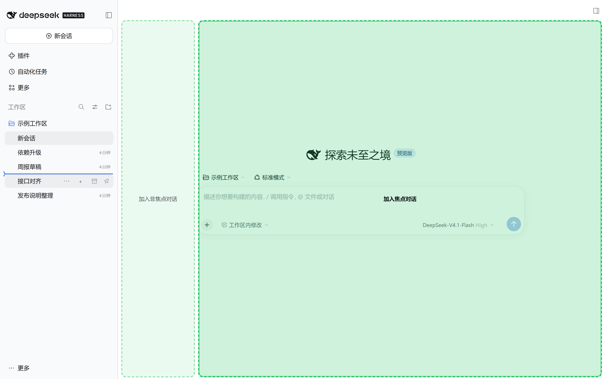
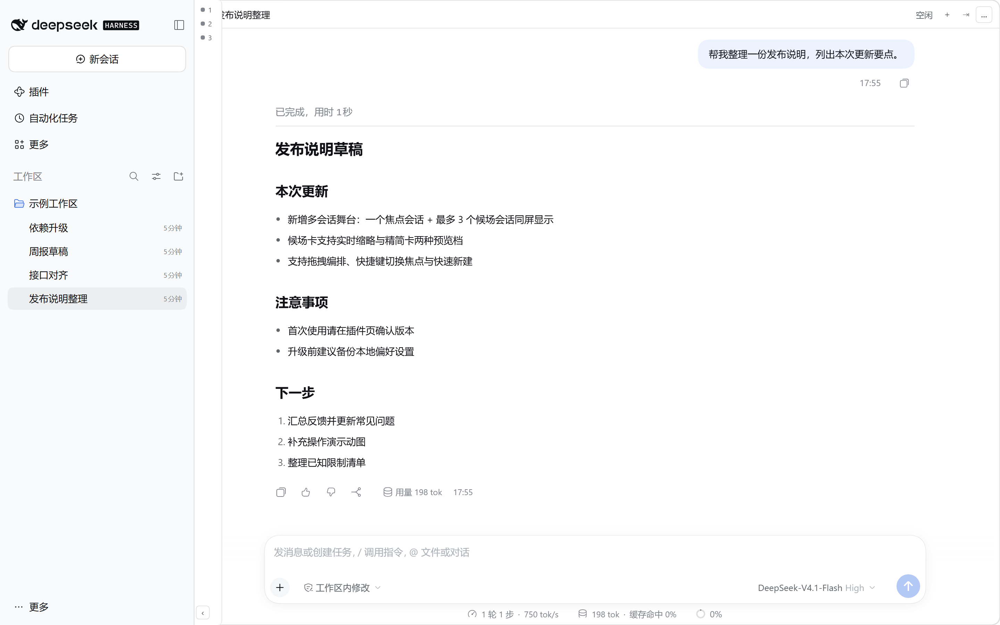

# dsh-onestep 会话舞台

> **dsh-onestep 0.7.0** — a DSH client plugin that turns the session main view into a stage.
> One focus session sits in the main area, with up to 12 staged candidate sessions on a left or top rail,
> shown as live thumbnail cards with completion and pending cues drawn on the windows themselves.
> Drag sessions from the official sidebar to arrange; companion panes open as right-side floats with
> 8-way edge resize and a collapsed tag stack on the right edge. View Transitions animate focus swaps,
> the UI follows DSH in zh/en, and the official UI is left intact: uninstalling restores the default view.
> Baseline: DSH Desktop 0.2.2-rc.1; engines.dsh = >=0.2.2-rc.1 <0.3.0-0 || >=0.2.1-rc.5 <0.2.2-0. MIT.


**dsh-onestep** 是一个 DSH 客户端插件（插槽 / slot 层实现，非 DSH 本体改动）：把 DSH 的会话主界面变成「1 个焦点会话 + 最多 12 个候场会话」的多会话舞台，并为舞台内的伴生窗提供独立浮窗、8 向缩放与右缘收起标签。

---

## 目录

- [1. 它解决什么问题](#1-它解决什么问题)
- [2. 核心体验](#2-核心体验)
- [3. 安装](#3-安装)
- [4. 快速上手](#4-快速上手)
- [5. 设置项](#5-设置项)
- [6. 已知限制（如实）](#6-已知限制如实)
- [7. 兼容范围](#7-兼容范围)
- [8. 隐私与安全](#8-隐私与安全)
- [9. 许可](#9-许可)
- [10. 文档索引](#10-文档索引)
- [11. 开发、构建与验证](#11-开发构建与验证)

---

## 1. 它解决什么问题

DSH 的会话界面是单焦点结构：左栏是目录（工作区 + 会话），中间是当前会话，右侧是伴生窗（文件、文档预览、浏览器、终端）。单个会话时这个结构非常高效；一旦并行任务变多，真实工作流就会变成：

- 在 3–6 个会话之间反复点左栏切换，注意力不断被打断；
- 后台会话跑完、等你批准、或提出问题时，往往只在左栏行上出现一个小状态点，很容易错过；
- 想把一个会话当主任务、把另外几个当候场盯着，DSH 没有「舞台」这一层。

Onestep 在**不改变官方左栏、不 fork DSH** 的前提下，给会话主界面加了一层「窗口化舞台」：

- **焦点会话**占据主位，完整可编辑（聊天体、composer、审批/计划、队列/Todo 都来自官方组件）；
- **候场会话**以卡片形式排在左侧或顶部，默认显示实时缩略画面，可拖拽编排；
- 会话的**完成/待处理状态直接显示在对应窗口上**，不需要回左栏找状态点；
- 退出舞台或卸载插件后，界面回到与官方完全一致的单会话体验。

设计上刻意保持「可逆」：插件只注册到 DSH 的插槽与快捷键系统，不修改 DSH 安装目录、不 patch 官方 bundle、不 fork 前端；舞台只在「有候场会话」时接管会话主区，候场清空即自动退出。

## 2. 核心体验

| 能力 | 一句话说明 |
|---|---|
| 舞台 | 1 个焦点会话 + 最多 12 个候场会话；默认最佳可读性为 1+3 |
| 候场卡 | √2:1 固定比例；默认实时缩略，可切精简卡；滚出视口自动降为精简卡 |
| 候场栏 | 左侧 / 顶部两种排布（按舞台宽度自动切换）；可拖比例、可收起、可滚动 |
| 编排 | 从官方左栏拖入：拖到焦点区 = 替换焦点，拖到候场栏 = 加入候场；超上限 LRU 淘汰 |
| 窗口级反馈 | 完成 → 卡片边框闪烁；等待批准/回答/计划 → 琥珀色气泡，点击提升为焦点 |
| 快速新建 | 焦点窗底部热区 / 快捷键唤出；回车建新会话并顶替焦点，文本先成为草稿 |
| 伴生浮窗 | 舞台内文件/文档/终端/浏览器在右侧独立浮窗打开，不挤窄焦点窗；槽位排开 |
| 浮窗操作 | 8 向边缘/角缩放（最小 220×140）；点击外部收起为右缘标签；标签整堆可拖动 |
| 动效 | 焦点↔候场、增删淘汰、候场栏收展走 View Transitions；支持 reduced-motion |
| 双语 | 中文 / English 文案跟随 DSH locale，热切换不重挂载窗口 |
| 性能 | 自动精简降级、滚出现场虚拟化、可收起候场栏；提供性能打点与探针 |
| 键盘与无障碍 | 全流程 Ctrl+Alt 快捷键（可在 DSH 快捷键页改键）、ARIA 角色/标签、状态双重编码 |

### 2.1 舞台：1 个焦点 + 最多 12 个候场

- **焦点会话**完整可交互；**候场会话**是非焦点的只读渲染：可看、不可输入，需要处理时提升为焦点。
- 候场卡固定 √2:1 比例（左栏约 232×148，顶部约 153×108），内部是按约 560px 逻辑宽度渲染的官方聊天体，等比缩放后显示最近画面；输入区被隐藏。
- 候场预览有两种档位，在焦点窗「…」菜单切换并持久化：
  - **实时缩略**（默认）：显示真实聊天画面；
  - **精简卡**：显示标题、状态与最近提问，资源开销更低。
- 候场栏按舞台宽度自动选择排布：舞台宽度 ≥1080 时在左侧，<1080 时在顶部；暂不提供手动切换方向。
- 候场栏与焦点窗之间可拖拽分隔条调整比例（左栏 200–320px、顶部 108–220px），也可一键收起（焦点窗占满，不退出舞台，保留展开手柄）。
- 候场上限 **12**。超过可视容量时保持卡片可读尺寸并滚动（滚轮或候场栏底部翻页按钮，左栏纵向、顶部横向）；滚出视口的卡自动降为精简卡、滚入后恢复实时缩略。
- 加入第 13 个候场会淘汰最久未使用的候场（LRU）；滚出视口的卡不挂载官方聊天体，因此 12 个候场并不会同时渲染 12 路实时画面。
- 候场清空自动退出舞台；没有候场时，界面与官方单会话完全一致。

窄屏行为：

- 会话主区 **< 760px**：提示「窗口过窄，已回到单会话」并退出舞台；
- 打开官方右栏把主区挤压变窄时，先进入 compact（隐藏候场栏、焦点窗单窗保活）；主区 **< 480px** 才退出。

### 2.2 拖拽编排、窗口级反馈与快速新建

- **拖拽编排**：从官方左栏把会话拖到焦点区 = 替换焦点；拖到候场栏 = 加入候场。落点 HUD 会显示「加入焦点对话」/「加入非焦点对话」。原焦点会自动降为候场，满 12 时淘汰最久未用。
- **窗口级操作**：焦点窗右下 88×88 触发角显示关闭控制点；候场卡 hover 整卡显示右下控制点；关闭与移出都可撤销（5 秒内点 toast「撤销」或按 `Ctrl+Alt+Z`）。
- **关闭语义**：关闭候场 = 移出舞台（不删除会话）；关闭焦点 = 提升最近候场为焦点；关闭最后一个窗口 = 退出舞台。
- **窗口级反馈**：
  - 候场会话完成 → 卡片边框闪烁（2×600ms）并显示「已完成，等待查看」；
  - 等待批准 / 等待回答 / 计划待确认 → 候场卡右下弹出琥珀色气泡，点气泡或卡片即可提升为焦点；
  - 状态同时用颜色、形状与文案表达，并通过 `aria-live` 播报（读屏可用）。
- **快速新建**：焦点窗底部热区 hover 滑出快速新建条，或点焦点窗右上「＋」，或按 `Ctrl+Alt+Shift+N`。输入后按 **Enter** 创建新会话并顶替焦点，文本先成为**草稿**（不自动发送）；鼠标移开 400ms 自动隐藏但保留草稿；`Esc` 两段式（非空先清空，再按收起）。

### 2.3 伴生浮窗与右缘收起标签

舞台模式下，会话里的文件、文档、终端、浏览器 tab 默认在屏幕右侧以**独立浮窗**打开，不挤窄焦点窗：

- **开关**：焦点窗工具栏的 **⇥** 按钮 = 伴生窗开/收（有可见浮窗时全部收起；有收起标签时恢复；没有任何浮窗时打开一个 guide 浮窗）。
- **槽位排开**：多浮窗按固定槽位横向排开，槽位数随舞台宽度自动计算（最多 3 个，窄屏 1 个）；同内容再次打开只聚焦已有窗；满槽时收起最久未聚焦的浮窗腾槽（内容不丢）。
- **点击外部收起**：点击浮窗外舞台区域，所有浮窗一起收起，右缘出现堆叠标签（图标 + 标题）；点标签（或聚焦后按 Enter/Space）逐个恢复。
- **收起标签整堆拖动**：在任意标签上按下并上下拖动即可移动整堆（不再只依赖顶部手柄）；松手在 10px 阈值内吸附到上/下沿或默认安全位置，位置持久化；标签层始终贴右缘。
- **8 向边缘缩放**：每个浮窗有 8 个透明把手（左右上下边 + 四角，边 6px / 角 12px 命中）；拖动实时预览，松手提交官方 `resizeFloat`（可撤销、持久化、刷新恢复）；最小尺寸 220×140，Esc 取消，点一下边缘（无位移）不提交。
- **左右分屏**：「…」菜单可把伴生窗切到「左右分屏」（回到官方右栏 push 形态），也可「恢复浮动」或「转回浮窗」；形态按会话记忆。
- **跟随焦点**：每个会话的伴生窗布局独立，切换焦点时自动跟随（浮窗形态按会话记忆）；浮窗矩形、tab 记录、右栏展开态由 DSH 官方持久化，插件只读取与对账，不覆盖官方记录。
- 浏览器 tab 仅**桌面 profile** 可用（见 §6 已知限制）。

### 2.4 动效与 reduced-motion

- 舞台几何变化（焦点↔候场交换、候场新增/淘汰/关闭、候场栏收起/展开）走 **View Transitions** 命名元素 morph：窗口是移动过去的，而不是硬切。
- 进入舞台 260ms；完成闪烁 2×600ms；菜单/picker/HUD/toast 等覆盖层 120–220ms；只动 opacity 与 transform，不做布局动画，也不自动播放循环动画。
- **点击候场卡换焦**走 320ms morph，动画期间焦点窗先显示轻量占位内容（标题/状态 + 骨架），官方聊天体与主绑定切换在动画内完成；键盘激活仍走 220ms 路径。
- 从官方左栏点击会话切焦点属于「外部主绑定切换」，启动动画前没有可拦截的时机，因此为直切（无 morph），功能不受影响。
- **减少动效**：跟随系统 `prefers-reduced-motion`，也可在焦点窗「…」菜单选择「动效：跟随系统 / 减少动效」（持久化）。减少动效时所有过渡为 0ms、跳过 View Transitions、无闪烁循环。
- View Transitions 依赖 Chromium ≥111；不支持时自动直切，功能不受影响。

### 2.5 双语（zh / en）

- 文案跟随 DSH 的界面语言（DSH「设置 → 通用 → 语言」），插件没有独立的语言开关。
- 中文 / English 字典各 75 个键，键集一致；语言热切换即时生效，**不重挂载**舞台窗口（不丢滚动位置与草稿）。
- 状态、按钮、气泡、toast、无障碍标签全部走 i18n；`npm run i18n:check` 会扫描硬编码文案与键完整性。

### 2.6 性能与自动精简

- 舞台为关键路径打 `performance.mark/measure`（进入舞台、换焦、内容就绪），探针快照里可读取最近记录。
- **自动精简**：4 窗且进入舞台首帧 >900ms、长任务累计 >400ms、或内存增量超预算时，本次舞台自动把候场切为精简卡（焦点窗保持实时缩略）。
  - 手动切档优先：用户手动切过档后，本次舞台会话内自动判定不再覆盖；
  - 自动降级**不写入用户偏好**，下次启动仍按用户保存的档位初始化；
  - 退出舞台后运行时状态清空。
- 候场超过可视容量时，滚出视口的卡自动降为精简卡（不挂官方聊天体），滚入再恢复；这是默认行为，不需要手动干预。
- 候场栏可一键收起，焦点窗获得全部主区宽度，适合临时专注或屏幕较小时使用。

### 2.7 键盘优先与无障碍

- 全流程可用键盘完成：进入/退出舞台、快速新建、换焦、提升候场、循环切换、撤销、调整比例、收起候场栏。
- 快捷键经 DSH 官方快捷键系统注册，可在 DSH 的快捷键页查看与改键；默认键位见 [§4.4](#44-键盘快捷键)。
- ARIA 角色与标签：舞台为 group、焦点窗为 region、候场窗为 group + 序号；分隔条、收起手柄、候选卡标题按钮、右缘收起标签都可聚焦与操作；状态点在颜色之外还有形状与文案双编码。
- 减少动效见 [§2.4](#24-动效与-reduced-motion)。

### 2.8 界面一览

以下截图来自 0.7.0 构建，在隔离 profile 中截取：









## 3. 安装

### 3.1 先确认支持范围

| 项 | 事实 |
|---|---|
| 插件版本 | `dsh-onestep` **0.7.0**（首个公开发布版本） |
| DSH 基线 | DSH Desktop **0.2.2-rc.1**（桌面 App 与 Web 端同源；在该版本上实测） |
| 声明支持范围 | `engines.dsh` = `>=0.2.2-rc.1 <0.3.0-0 \|\| >=0.2.1-rc.5 <0.2.2-0` |
| 版本策略 | 跟随 DSH 后续 rc：发布时声明「当前最新 rc + 上一个 rc」，每次 rc 发布后做契约 diff 与兼容回归 |

超出支持范围的 DSH 版本不做承诺。升级 DSH 前请先看 [docs/compatibility.md](docs/compatibility.md)。

### 3.2 桌面 App（推荐安装路径）

1. 打开 DSH 桌面 App 的 **Plugins / 插件页**（或社区市场入口），选择安装/启用 `dsh-onestep`；
2. **首次安装后重启 DSH**（插件在启动时装载）；
3. 之后可在 Plugins 页卸载或回滚版本。

注意：**桌面 profile 由 Electron 应用独占管理**。CLI 对 `desktop` profile 仅只读 `list` 可用，`add`/启动会被拒绝：

```text
profile "desktop" is managed exclusively by the Electron application
```

查看桌面 profile 已装插件（只读）：

```powershell
& "<DSH 安装目录>\resources\runtime\cli\bin\dsh.cmd" plugin --profile desktop list
```

### 3.3 隔离 profile（开发、验证、排障用）

隔离 profile 不会碰桌面 App，适合验证安装、调试插件或复现问题。

```powershell
# 1) 从内置 web 模板创建隔离 profile（会重置该 profile 的插件安装）
& "<DSH 安装目录>\resources\runtime\cli\bin\dsh.cmd" onestep-dev --from-default-profile web --no-open --port 4650

# 2) 把本仓库装进隔离 profile（目录链路；开发时改 client.js 刷新页面即生效）
& "<DSH 安装目录>\resources\runtime\cli\bin\dsh.cmd" plugin --profile onestep-dev add "<本仓库目录>"
```

打开启动输出里的访问 URL（形如 `http://127.0.0.1:<port>/?token=<token>`；token 每次重启都会变化）。

关于「隔离」的边界，如实说明：

- `--from-default-profile web` **只隔离插件配置**，会话目录仍共用 `~/.dsh`，不构成会话数据隔离；
- `plugin add` 会自动把包名写进该 profile 的 `dsh.profile.bundles`（bundles 才是激活开关，仅有依赖不会加载），无需手改 profile 的配置文件。

### 3.4 从 npm 安装（发布到 npm 之后）

`dsh-onestep` 发布到 npm 后，隔离 profile 可以直接按包名安装：

```powershell
& "<DSH 安装目录>\resources\runtime\cli\bin\dsh.cmd" plugin --profile onestep-dev add dsh-onestep
```

桌面 App 仍走 Plugins 页安装（见 §3.2），不要对 `desktop` profile 使用 CLI 安装。

### 3.5 更新、卸载与回滚

- **桌面 App**：在 Plugins 页检查更新 / 重装目标版本，随后重启 DSH。
- **隔离 profile**：重新执行 `plugin --profile onestep-dev add`（目录链路或目标版本），随后重启实例。
- **卸载 / 回滚**：

```powershell
& "<DSH 安装目录>\resources\runtime\cli\bin\dsh.cmd" plugin --profile onestep-dev remove dsh-onestep
```

卸载后重启实例：boot 条目回落、`window.__ONESTEP__` 与舞台 DOM 消失、官方会话与 composer 正常。

已知残留：`remove` 后 `node_modules` 里可能留下 link/Junction 与插件管理器日志，不影响运行；要彻底干净可以重建 profile。

## 4. 快速上手

### 4.1 第一次进入舞台

任选一种入口：

1. **左栏会话行 hover →「加入舞台」**：该会话进入候场并立即挂载舞台；
2. **会话头「舞台」按钮**：打开多选浮层，勾选候场会话 →「进入舞台（N）」；
3. **快捷键 `Ctrl+Alt+S`**：无候场时打开选择浮层，已有候场时退出舞台；
4. **拖拽**：普通模式下把左栏会话拖到会话区，落点 HUD 显示「加入焦点对话」/「加入非焦点对话」。

### 4.2 进入舞台之后

- 焦点会话 = 你当前正在查看的会话；候场会话以实时缩略卡排在候场栏（默认左侧，舞台较窄时在顶部）；
- 舞台只占用官方会话主区，**不覆盖官方左栏**，官方右栏仍可用；
- 候场上限 12，满员时加入第 13 个会淘汰最久未用的候场；超过可视容量可滚动；
- 退出舞台：`Ctrl+Alt+S`、焦点窗「…」菜单「退出舞台」、或关闭最后一个窗口；退出后候场会话仍在官方左栏（不删除会话）；
- 候场清空自动退出舞台，恢复官方单会话界面；
- 窄屏（主区 <760px）会提示并退出；官方右栏挤入时先 compact、再必要时退出（见 §2.1）。

### 4.3 日常操作速查

| 操作 | 方式 |
|---|---|
| 切换焦点 | 点击候场卡；点击官方左栏会话行；`Ctrl+Alt+2…9` 提升第 1…8 个候场；`Ctrl+Alt+←/→` 循环 |
| 拖拽编排 | 左栏会话拖到焦点区 = 替换焦点，拖到候场栏 = 加入候场；原焦点自动降为候场 |
| 快速新建 | 焦点窗底部热区 / 右上「＋」，或 `Ctrl+Alt+Shift+N`；Enter 创建（文本先成为草稿），Esc 两段式 |
| 关闭 / 移出 | 焦点窗右下触发角出关闭点；候场卡 hover 出右下控制点；5 秒内可撤销 |
| 调整候场栏比例 | 拖分隔条；聚焦分隔条后 `←/→`（左栏）或 `↑/↓`（顶部），Shift 24px，Home/End 到边界 |
| 收起候场栏 | 候场栏手柄一键收起（焦点窗占满、不退出舞台）；键盘可达 |
| 候场预览档 | 焦点窗「…」菜单：实时缩略 ↔ 精简卡（持久化） |
| 自动精简 | 默认开启，超预算时自动把候场切精简卡；手动切档优先（见 §2.6） |
| 伴生浮窗 | 舞台内点文件/文档/终端/浏览器链接 → 右侧浮窗；焦点窗 **⇥** 开/收；拖边/角缩放；点浮窗外收起 |
| 收起标签 | 点右缘标签恢复；在任意标签上上下拖动移动整堆；顶部手柄聚焦后 ↑↓ / Shift+↑↓ / Home/End 调位置 |
| 浮窗与右栏互转 | 浮窗「…」菜单：左右分屏 / 恢复浮动；有收回项时显示「转回浮窗」 |
| 官方右栏 | 焦点窗「…」菜单「打开官方右栏」（push 形态，切焦点自动跟随） |

### 4.4 键盘快捷键

| 操作 | 默认键位（Windows） | 说明 |
|---|---|---|
| 进入 / 退出舞台（或打开选择浮层） | `Ctrl+Alt+S` | 有候场时退出；无候场时打开多选 |
| 快速新建条 | `Ctrl+Alt+Shift+N` | 打开 / 聚焦快速新建条 |
| 关闭焦点窗（提升最近候场） | `Ctrl+Alt+Shift+W` | 与官方保留序列冲突已避让 |
| 撤销关闭 | `Ctrl+Alt+Z` | 5 秒窗口内有效 |
| 回到焦点会话输入 | `Ctrl+Alt+1` | 聚焦焦点窗 composer |
| 提升第 1…8 个候场 | `Ctrl+Alt+2…9` | 第 9 个起用滚动 + 点击/标题按钮提升 |
| 焦点循环 | `Ctrl+Alt+←/→` | 上一个 / 下一个窗口 |
| 候场卡键盘 | 标题按钮 Enter/Space 提升；右下控制点 Delete/Backspace 移出 | 键盘可达 |
| 收起 / 展开候场栏 | 聚焦收起手柄后 Enter/Space | `aria-expanded` 表达状态 |
| 调整候场栏比例 | 聚焦分隔条后方向键 | `Shift` 24px，`Home/End` 到边界 |
| 右缘标签 | Tab/方向键聚焦，Enter/Space 恢复 | 在任意标签上上下拖动可移动整堆；顶部手柄聚焦后 ↑↓（Shift 24px）/ Home/End 调位置 |

> 键位经 DSH 官方快捷键系统注册，可在 DSH 的快捷键页改键；默认值仅注册 Windows 平台（web 与 desktop 两套），macOS / Linux 用户请在该页自行绑定。

## 5. 设置项

### 5.1 可用设置

| 设置 | 入口 / 取值 | 说明 |
|---|---|---|
| 候场预览档 | 焦点窗「…」菜单：实时缩略 ↔ 精简卡 | 默认实时缩略；精简卡显示标题/状态/最近提问；持久化 |
| 自动精简（lite） | 内部开关（默认开，阈值可配置） | 4 窗超预算时自动切精简候场；手动切档优先、不覆盖用户偏好 |
| 候场栏方向 | 自动 | 舞台宽度 ≥1080 左侧，<1080 顶部；暂不提供手动切换 |
| 候场栏比例 / 收起 | 分隔条 / 收起手柄 | 持久化 |
| 语言 | 跟随 DSH locale（zh / en） | DSH「设置 → 通用 → 语言」；插件文案即时切换、不重挂载窗口 |
| 主题 | 跟随 DSH 明暗主题 | DSH「设置 → 通用 → 外观」；深浅色均适配 |
| 动效 | 焦点窗「…」菜单：动效：跟随系统 / 减少动效 | 持久化；减少动效时全部过渡为 0ms、无 View Transitions、无循环动画 |
| 舞台持久化 | 内部状态 `persistStage`（默认开） | 刷新后恢复候场 roster 与布局；当前无 UI 入口 |

### 5.2 持久化与重置

| 存储键 | 归属 | 内容 |
|---|---|---|
| `dsh.onestep.v1` | 插件（舞台） | 候场 roster、候场栏方向/尺寸/收起、预览档、自动精简、`persistStage`、动效设置；300ms 节流写入；**不含会话内容/凭据** |
| `dsh.onestep.companion.v1` | 插件（伴生窗） | 伴生窗形态（float/split）、槽位映射、被收起的窗集合、已收回右栏的 tab、收起标签纵向位置；**不含内容/凭据**；收起集合不跨刷新 |
| `dsh.sidebar-right.v1.*` | DSH 官方 | 官方浮窗矩形、tab 记录、右栏展开态；插件只读对账，不覆盖 |

重置设置（仅在排障时使用）：在 DSH 页面的开发者工具 Console 执行以下命令后刷新页面：

```js
localStorage.removeItem("dsh.onestep.v1")
localStorage.removeItem("dsh.onestep.companion.v1")
```

## 6. 已知限制（如实）

### 6.1 依赖非公开扩展点（使用即接受 rc 升级风险）

DSH 的客户端插件公开 API 仍处 pre-stable。为了做出「不改 DSH 本体」的舞台与浮窗，0.7.0 依赖以下**非公开扩展点**；能力自检失败时会自动退回官方右栏行为，不阻塞官方 UI：

1. **运行时包装官方 `ctx.sidebarRight.openResource` / `openTab`**：官方没有「重定向打开位置」的公开扩展点，插件在运行时包装这两个顶层入口以把伴生 tab 引导到浮窗；卸载/热重载时精确还原。
2. **官方浮窗 DOM 注入与选择器**：对官方浮窗元素注入 `data-onestep-peek` / `inert` / `aria-hidden` 与样式，并自绘右缘标签层与 8 向缩放把手；官方没有「收起但保留」与任意边缘缩放的公开 API。
3. **沿 React fiber 读取官方 FloatLayer 的 `intents.resizeFloat`**：浮窗矩形提交优先调用官方 `resizeFloat`；取不到时回退到官方 controller 的私有 store actions；仍失败则只还原预览并记录日志、不改变官方状态。
4. **只读官方 localStorage**：读取官方 `dsh.sidebar-right.v1.*` 做对账，不写入。

DSH 每次 rc 升级都可能移动这些内部结构。升级前请按 [docs/compatibility.md](docs/compatibility.md) 的契约 diff 清单逐项核对，并跑兼容冒烟与单测；不能确认兼容时，唯一保证是插件自动回退到官方行为（或按 [§3.5](#35-更新卸载与回滚) 卸载）。

### 6.2 交互限制

- **浮窗缩放没有键盘等价路径**：8 向缩放只支持指针操作（与官方右下角缩放一致）；需要键盘时可先切回官方右栏形态。
- **收起标签拖动只改纵向位置**：标签层始终贴右缘，不横向自由停靠；松手吸附阈值为上/下沿与默认安全位置各 10px。
- **已有浮窗不会动态重排**：官方没有公开的 move/resize API，新浮窗按槽位落位；用户手动拖过/缩过的浮窗由官方持久化，插件不覆盖。
- **浏览器伴生 tab 仅桌面 profile 可用**：官方按 profile 名门控 `ui-sidebar-browser` bundle；web / 隔离 profile 按设计降级（文件、文档、终端仍可用，浏览器 tab 不承诺）。
- **舞台模式下官方 header 不复用**：窗口 chrome 由插件自绘，官方 header 的视图页签等贡献在舞台内不可用；退出舞台即恢复官方 header。
- **从官方左栏切焦点无 morph 动效**：外部主绑定切换无法在 DOM 变化前启动 View Transitions，因此直切；插件内动作（点击候场卡、快捷键、关闭）有动效。
- **候场滚动位置不持久化**：刷新后回到候场栏顶部；`Ctrl+Alt+2…9` 只覆盖前 8 个候场，第 9 个起用滚动 + 点击提升。

### 6.3 v1.1 候选、本版本未实现

- **极简档（状态条收栏）未实现**：连续低帧率 / 内存超限时把舞台收为状态条的「极简档」只是 v1.1 候选，0.7.0 没有实现；当前超预算时回退为「候场自动切精简卡」。

## 7. 兼容范围

### 7.1 版本与基线

- **插件版本**：`0.7.0`（`package.json` 与宿主半 `index.js` 的版本常量一致）。
- **DSH 基线**：DSH Desktop `0.2.2-rc.1`；`engines.dsh` = `>=0.2.2-rc.1 <0.3.0-0 || >=0.2.1-rc.5 <0.2.2-0`。上界用 `<x.y.z-0` 是为了在宿主 `semver.satisfies(..., { includePrerelease: true })` 语义下真正排除下一个 rc。
- **上一 rc 的验证状态**：`0.2.1-rc.5` 分支目前**仅按 semver 声明支持**，未做装机实测；完整验证在基线 `0.2.2-rc.1` 上完成。
- **版本策略**：跟随后续 DSH rc，每次 rc 发布后做契约 diff、兼容冒烟与适配发版；发布时声明「当前最新 rc + 上一个 rc」，更早版本不承诺。

### 7.2 rc 升级时的契约 diff

插件把对 DSH 的依赖集中在 `src/client/adapter.js`（插槽名、服务方法、DOM 选择器、存储键、限额），升级 DSH 时按以下顺序处理（细节见 [docs/compatibility.md](docs/compatibility.md)）：

1. 读 DSH 新 rc 的变更/源码 diff，重点核对插槽名、`sessions` 服务、浮窗 DOM 选择器、FloatLayer 矩形提交路径、快捷键注册 API；
2. 先跑单测与 `node scripts/build.mjs --check`，确认构建链路未断；
3. 在隔离 profile 冒烟：舞台进入/退出、换焦、浮窗打开/收起/缩放、语言与主题切换、卸载回落；
4. 只在 `adapter.js` 与必要的兼容层改代码，重新构建并更新 `engines.dsh`；
5. 记录到 [CHANGELOG.md](CHANGELOG.md) 与 [docs/compatibility.md](docs/compatibility.md)。

### 7.3 失败隔离

- 插槽渲染出错会被错误边界接住：该窗口显示「内容渲染失败」，官方界面与其它窗口继续工作；关键能力缺失时插件自动退普通模式。
- **bundle 本身加载失败会阻塞整页 boot**（DSH 的 boot 图契约）。这是 DSH 的机制，不是插件引入的失败模式：发布前必须冒烟；一旦出现，卸载插件并重启即可恢复官方界面。
- 插件不修改 DSH 安装目录、不 patch 官方 bundle、不依赖运行时 import 其他 feature 插件。

## 8. 隐私与安全

### 8.1 插件会碰什么数据

- **无网络外发、无遥测**：插件不发起任何网络请求，不采集、不上报使用数据；运行时只有仓库内的 `index.js` / `client.js`，无第三方运行时依赖，不做远程代码加载。
- **只使用本地 localStorage**：两个插件键（见 [§5.2](#52-持久化与重置)），只存舞台/伴生窗的布局与偏好，**不含会话正文、不写凭据**。
- **不读凭据、不采集会话内容**：插件不访问凭据文件，不把会话正文写入日志或存储；宿主半（Node 侧）默认只记录 apply/dispose 探针事件，JSONL 日志仅在显式配置 `probeLog` 或环境变量 `ONESTEP_P0_LOG` 时写文件。
- **诊断面可脱敏**：`window.__ONESTEP__` 为只读快照 + 动作面，快照含会话 ID 与会话标题采样；提 issue 前请自行脱敏。可选探针面板通过 Console 执行 `localStorage.setItem("dsh.onestep.probe", "1")` 后刷新开启（移除并刷新关闭）。

### 8.2 环境安全边界（如实披露）

1. **本机回环地址上的 `/plugins/**` 无鉴权**：同机任意进程可匿名读取插件 bundle（`/` 与 `/api` 有 token/cookie 准入）。这是 DSH 插件分发机制本身的暴露面，不是本插件引入；不要把 DSH 实例暴露到不可信网络。
2. **插件与页面同权限**：客户端半运行在 DSH 页面上下文中（可读 DOM、localStorage 等）；威胁模型不覆盖已被入侵的本机、恶意 DSH 插件或其他同权限扩展。
3. **桌面 profile 由 Electron 应用管理**：桌面侧安装/启用/卸载只经 App 的 Plugins 页；CLI 对 desktop profile 仅只读 `list` 可用。
4. **bundle 加载失败会阻塞整页 boot**：发布前必须冒烟；恢复方式是卸载插件并重启（见 §7.3）。

### 8.3 报告安全问题

请不要在公开 issue / 讨论区报告安全漏洞，也不要贴出可复现的攻击细节。首选 GitHub Private Vulnerability Reporting；渠道尚未就绪时，开一个只写「需要安全报告渠道」的 issue（不含任何漏洞细节）。响应不承诺 SLA，本项目不提供漏洞赏金。完整口径、支持版本与报告范围见 [SECURITY.md](SECURITY.md)。

## 9. 许可

- 本仓库与 npm 包采用 **MIT** 许可证，见 [LICENSE](LICENSE)。
- 版权声明：`Copyright (c) 2026 dsh-onestep contributors`。
- 分发时请保留 LICENSE 中的版权与许可声明；`npm pack` 的包内也包含 `LICENSE`。
- 开发依赖（`esbuild`、`playwright-core` 等）不随包发布，包内运行时只有 `index.js` / `client.js`。

## 10. 文档索引

| 文档 | 读者 | 内容 |
|---|---|---|
| [README.md](README.md) | 第一次接触的用户 | 项目定位、核心体验、安装、快速上手、快捷键、设置、已知限制、兼容、隐私 |
| [docs/user-guide.md](docs/user-guide.md) | 日常使用者 | 完整操作手册：舞台、浮窗、标签、快捷键、设置与故障排查 |
| [docs/architecture.md](docs/architecture.md) | 开发者 / 二次开发 | 插件形态与装载、自适应接管、状态层、浮窗层、动效层、模块地图 |
| [docs/compatibility.md](docs/compatibility.md) | 维护者 / 升级 DSH 的人 | 支持范围、依赖的契约面、rc 升级 diff 清单与回退 |
| [docs/release/checklist.md](docs/release/checklist.md) | 发布负责人 | 0.7.0 发布检查表与签署项 |
| [docs/release/evidence.md](docs/release/evidence.md) | 发布负责人 / 审计者 | 0.7.0 证据索引与可复跑命令 |
| [docs/review/0.7.0-pre-release.md](docs/review/0.7.0-pre-release.md) | 审阅者 | 发布前代码审查：发现、修复与二次验证 |
| [CHANGELOG.md](CHANGELOG.md) | 所有用户 | 变更日志与版本策略 |
| [SECURITY.md](SECURITY.md) | 安全报告者 / 部署者 | 漏洞渠道、支持版本、隐私与安全边界 |
| [LICENSE](LICENSE) | 所有人 | MIT 许可证 |
| [docs/README.md](docs/README.md) | 所有人 | 文档总索引与阅读路径 |
| [src/client/](src/client/) | 开发者 | 浏览器半源码（22 个模块） |
| [tests/store.test.mjs](tests/store.test.mjs) | 开发者 | node:test 单测（13 个文件、151 条；此为示例文件） |
| [scripts/build.mjs](scripts/build.mjs) | 开发者 / 发布负责人 | 构建脚本；兼容、i18n、门禁与发布自查脚本在 `scripts/` 下 |

## 11. 开发、构建与验证

### 11.1 仓库结构（入库部分）

```text
dsh-onestep/
├─ README.md                  # 本文档
├─ CHANGELOG.md               # 变更日志（Keep a Changelog）
├─ SECURITY.md                # 安全政策
├─ LICENSE                    # MIT
├─ icon.svg                   # 插件图标（纯 SVG）
├─ package.json               # 双 manifest：dsh.bundle（cordis.patch.yml）+ dsh.client（web 平台）
├─ package-lock.json
├─ cordis.patch.yml           # profile bundle patch：把本包挂进 loader 树
├─ index.js                   # 宿主半（ESM）：apply/dispose 探针与生命周期
├─ client.js                  # 浏览器半（构建产物，CJS 工厂）：舞台 + 浮窗 + window.__ONESTEP__
├─ src/client/                # 浏览器半源码（模块化，esbuild 构建为 client.js）
├─ tests/                     # node:test 单测（13 个文件，151 条）
├─ scripts/                   # 构建、验证、门禁脚本
├─ docs/                      # 公开文档与截图（docs/assets）
└─ .github/                   # issue 模板
```

### 11.2 常用命令

| 命令 | 作用 |
|---|---|
| `npm test` | 单测（node:test，13 个测试文件） |
| `npm run i18n:check` | 校验 zh/en 字典键集一致、无硬编码文案 |
| `npm run build` | 用 esbuild 构建 `client.js` |
| `npm run build:check` | 用 esbuild 重新构建并报告产物字节数（不写盘，用于确认源码可构建） |
| `node --check client.js` | 校验产物语法 |
| `npm run compat:engines` | 校验 `engines.dsh` 与宿主语义一致 |
| `npm pack --dry-run` | 预览 tarball 内容（6 个文件） |

构建产物由 `scripts/build.mjs` 生成（esbuild，cjs、chrome120、11 项平台模块 external），可从 `src/client/**` 逐字节复现。

### 11.3 当前版本的验证结果

| 项 | 结果 |
|---|---|
| 单测 `npm test` | **151 / 151 通过** |
| i18n `npm run i18n:check` | zh / en 各 **75 键**，键集一致、无硬编码 |
| 构建产物 | `node --check client.js` 通过；`node scripts/build.mjs` 连续构建结果一致（同字节数、同 sha256） |
| 产物大小 / 哈希 | `client.js` **324696 B** / sha256 `CC3D0F1C11A7C790B993677F61DB8117DB741DA345B577D751AC566D6FF76993` |
| tarball | `dsh-onestep-0.7.0.tgz` **95272 B** / sha256 `65F57DA1F075FDB78DE4EA10DA291D77C4EEA89DFC409E5697458BA68214BC1A` |
| tarball 内容 | 6 个文件：`LICENSE` / `README.md` / `client.js` / `cordis.patch.yml` / `index.js` / `package.json` |
| 安装演练 | 全新隔离 profile 从 tarball 安装 → 启动 → 舞台冒烟 → 卸载回落通过（见发布前审查报告） |

```text
# 校验（在仓库根目录）
node scripts/build.mjs --check   # 重新构建并报告产物字节数（不写盘）
node --check client.js           # 产物语法
node -e "const crypto=require('node:crypto'),fs=require('node:fs');console.log(crypto.createHash('sha256').update(fs.readFileSync('client.js')).digest('hex').toUpperCase())"
npm pack --dry-run
```

发布门禁、证据索引与逐项结论见 [docs/release/checklist.md](docs/release/checklist.md) 与 [docs/release/evidence.md](docs/release/evidence.md)；发布前的完整审查与修复记录见 [docs/review/0.7.0-pre-release.md](docs/review/0.7.0-pre-release.md)。

### 11.4 开发排障开关

浏览器地址后追加 hash 可逐个禁用子系统（开发/定位问题用）：

```text
#onestep=no-locale,no-shortcuts,no-entries,no-overlay,no-sessions,no-main
```

分别对应：文案注册、快捷键注册、入口按钮、覆盖层、会话订阅、接管 `main` 槽。宿主半日志仅在配置 `probeLog` 或环境变量 `ONESTEP_P0_LOG` 时写 JSONL 文件（默认不落盘）。
