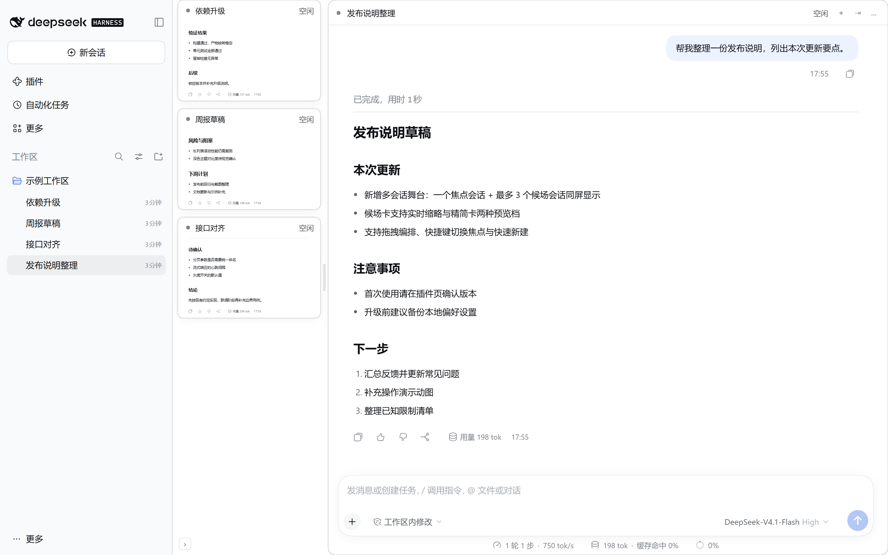
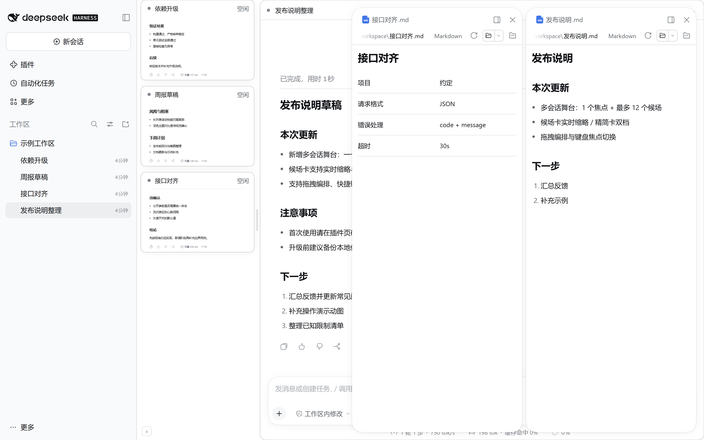

# dsh-onestep 一步

> **1.0.2** · DSH 客户端插件 · 把会话主界面变成「1 个焦点 + 最多 12 个候场」的舞台
>
> 焦点会话占主位、候场会话以静态快照卡排在左/顶栏；会话在窗口上直接显示完成/待处理；
> 伴生窗以右侧浮窗打开（8 向缩放、收起为右缘标签）。不 fork DSH、不改官方左栏，
> 退出舞台或卸载即恢复官方单会话界面。MIT。



## 它解决什么问题

DSH 的会话界面是单焦点结构：并行任务一多，就要在 3–6 个会话间反复点左栏切换，后台会话的完成/待批准/提问又只体现在左栏一个小状态点上，很容易错过。

Onestep 在不改 DSH 本体的前提下加了一层「窗口化舞台」：焦点会话完整可编辑内容仍来自官方组件，候场会话只读渲染成卡片，状态直接画在窗口上；舞台只接管会话主区，候场清空自动退出。

## 核心能力

| 能力 | 说明 |
|---|---|
| 舞台 | 1 焦点 + 最多 12 候场；默认最佳可读性 1+3，左栏溢出可滚动、LRU 淘汰 |
| 候场卡 | √2:1 比例；默认静态快照（仅状态/标题变化时重拍），可切精简卡 |
| 候场栏 | 左/顶两种排布（按舞台宽度自动切换）；自由拖比例、可收起 |
| 编排 | 从左栏拖入：拖到焦点区=替换焦点，拖到候场栏=加入候场；关闭 5 秒内可撤销 |
| 窗口级反馈 | 完成→边框闪烁；待批准/回答/计划→琥珀气泡，点即提升 |
| 快速新建 | 底部热区 / 右上「＋」/ `Ctrl+Alt+Shift+N`；Enter 建会话，文本先成草稿 |
| 伴生浮窗 | 文件/文档/终端/浏览器在右侧独立浮窗；槽位随宽度排开 |
| 浮窗操作 | 8 向边缘/角缩放（最小 220×140）；点外部收起为右缘标签；标签整堆可拖 |
| 动效 / 双语 / 键盘 | View Transitions morph + reduced-motion；zh/en 跟随 DSH；全程快捷键与 ARIA |




## 安装

| 方式 | 步骤 |
|---|---|
| 桌面 App（推荐） | Plugins / 插件页安装 `dsh-onestep` → **重启 DSH**；之后可在同一页卸载/回滚 |
| 隔离 profile（开发/排障） | 用 CLI 建 profile 并安装，见下 |
| npm（当前 1.0.2，随本次发布生效） | `plugin --profile <p> add dsh-onestep@1.0.2` |

`desktop` profile 由 Electron 应用独占：CLI 只能 `list`，`add` 会被拒绝。

```powershell
# 隔离 profile：创建 → 安装本仓库 → 打开输出里的 URL
& "<DSH 安装目录>\resources\runtime\cli\bin\dsh.cmd" onestep-dev --from-default-profile web --no-open --port 4650
& "<DSH 安装目录>\resources\runtime\cli\bin\dsh.cmd" plugin --profile onestep-dev add "<本仓库目录>"
```

隔离 profile 只隔离插件配置，会话目录仍共用 `~/.dsh`。卸载：`plugin --profile <p> remove dsh-onestep`，重启后 boot 条目与 `window.__ONESTEP__` 回落。

## 三分钟上手

1. **进舞台**：左栏会话行 hover「加入舞台」/ 会话头「舞台」按钮 / `Ctrl+Alt+S` / 直接拖拽；
2. **换焦**：点候场卡、点左栏会话、`Ctrl+Alt+2…9`；拖拽可替换焦点或加入候场；
3. **退出**：`Ctrl+Alt+S`、焦点窗「…」→「退出舞台」，或关闭最后一个窗口；候场清空也会自动退出。

| 快捷键（Windows 默认） | 作用 |
|---|---|
| `Ctrl+Alt+S` | 进出舞台（无候场时打开选择浮层） |
| `Ctrl+Alt+Shift+N` | 快速新建条 |
| `Ctrl+Alt+1` / `Ctrl+Alt+←/→` | 回到焦点输入 / 焦点循环 |
| `Ctrl+Alt+2…9` | 提升第 1…8 个候场 |
| `Ctrl+Alt+Z` / `Ctrl+Alt+Shift+W` | 撤销关闭 / 关闭焦点窗 |

键位经 DSH 官方快捷键系统注册，可在 DSH 快捷键页改键（默认仅注册 Windows 两套 profile）。

## 设置与存储

- **候场预览档**：静态快照（默认）↔ 精简卡，焦点窗「…」菜单切换并持久化；超过预算时自动切精简卡，手动选择优先。
- **动效**：跟随系统 / 减少动效（持久化）；减少动效时无 View Transitions、无循环动画。
- **语言与主题**：跟随 DSH locale 与明暗主题，热切换不重挂载窗口。
- **本地存储**：`dsh.onestep.v1`（舞台布局/偏好）与 `dsh.onestep.companion.v1`（浮窗形态/槽位/收起集合），300ms 节流写入，**不含会话正文与凭据**。
- 排障重置：Console 执行 `localStorage.removeItem("dsh.onestep.v1")`、`localStorage.removeItem("dsh.onestep.companion.v1")` 后刷新。

## 已知限制（如实）

- 依赖 DSH 的非公开扩展点（运行时包装 `sidebarRight.openResource/openTab`、浮窗 DOM 注入、fiber `intents.resizeFloat`、只读官方存储键）；rc 升级需按 [兼容性文档](docs/compatibility.md) 做契约 diff，能力自检失败会回退官方行为。
- 浮窗缩放无键盘等价路径；收起标签只能纵向拖动；两者与官方行为对齐。
- 「再点链接展开收起浮窗」只覆盖默认放置；显式 `destination`/`paneId` 直通官方。
- 浏览器伴生 tab 仅桌面 profile 可用（官方按 profile 门控）。
- 舞台模式下官方 header 不自绘复用；从左栏切焦点为直切（无 morph）。
- 候场快照是静态 DOM 克隆而非位图：首次/状态变化时需挂载一次官方内容（约 0.15–0.4s/卡，串行）。
- 候场滚动位置不持久化；「极简档」为 v1.1 候选、本版未实现。

## 兼容范围

| 项 | 值 |
|---|---|
| 插件版本 | `1.0.2`（package.json 与 index.js 版本常量一致） |
| 实测基线 | DSH Desktop **0.2.2-rc.5**（2026-11-21 安装/舞台/浮窗复验）与 **0.2.2-rc.1**（收口前全量实测） |
| 声明范围 | `engines.dsh` = `>=0.2.2-rc.1 <0.3.0-0 \|\| >=0.2.1-rc.5 <0.2.2-0` |

升级 DSH 前先读 [docs/compatibility.md](docs/compatibility.md)：契约面集中在 `src/client/adapter.js`，流程是「diff 插槽/服务/DOM/浮窗提交路径 → 单测与 `build:check` → 隔离 profile 冒烟 → 只改适配层并发版」。

## 隐私与安全

- **无网络外发、无遥测**：不发起网络请求、不采集使用数据，不加载远程代码。
- **不读凭据、不采集正文**：只在本地存布局偏好；宿主半默认只记录 apply/dispose 探针事件。
- **诊断面**：`window.__ONESTEP__` 是对局部的只读快照 + 动作面，含会话 ID/标题采样，提 issue 前请自行脱敏。
- **环境边界**：本机回环 `/plugins/**` 无鉴权（DSH 分发机制本身）；插件与页面同权限；bundle 加载失败会阻塞整页 boot，恢复方式是卸载并重启。
- 安全问题请走 [SECURITY.md](SECURITY.md) 的渠道，不要在公开 issue 贴漏洞细节。

## 许可

MIT · `Copyright (c) 2026 Huaxingmo` · 见 [LICENSE](LICENSE)。分发请保留许可声明；npm 包内含 `LICENSE` 与 `README`。

## 文档与开发

| 文档 | 内容 |
|---|---|
| [docs/user-guide.md](docs/user-guide.md) | 完整操作手册：舞台、浮窗、标签、快捷键、设置、排障 |
| [docs/architecture.md](docs/architecture.md) | 插件形态、状态层、浮窗层、动效层与模块地图 |
| [docs/compatibility.md](docs/compatibility.md) | 支持范围、契约面、rc 升级 diff 清单 |
| [docs/release/checklist.md](docs/release/checklist.md) · [evidence.md](docs/release/evidence.md) | 1.0.0 发布门禁、签署与证据索引 |
| [docs/review/2026-11-20-review.md](docs/review/2026-11-20-review.md) | 收口前审查、修复与复验记录 |
| [CHANGELOG.md](CHANGELOG.md) · [SECURITY.md](SECURITY.md) | 变更日志 / 安全渠道 |

开发：`npm install` → `node scripts/build.mjs`（产物 `client.js`）→ `npm test` → `npm run check`（单测 + 构建一致性 + i18n + 版本范围 + 文档）。
