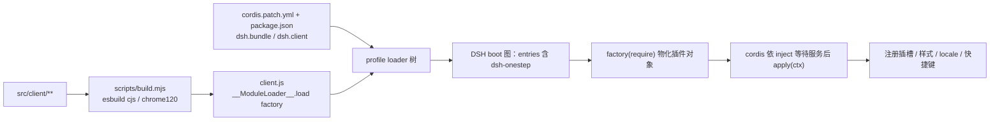
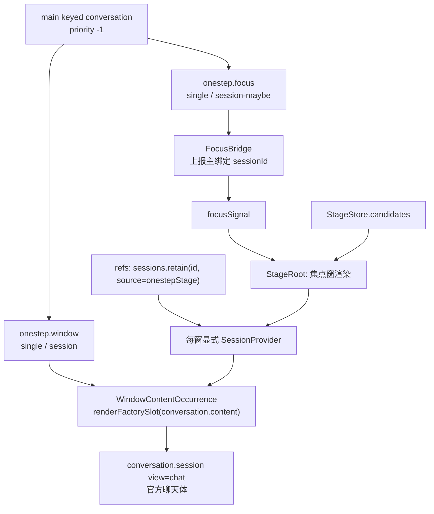
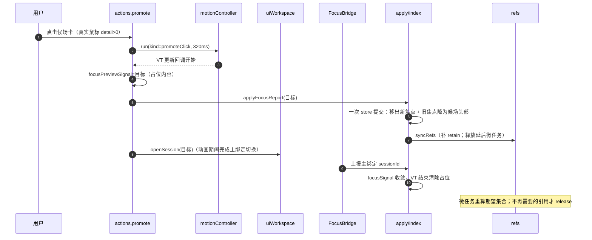
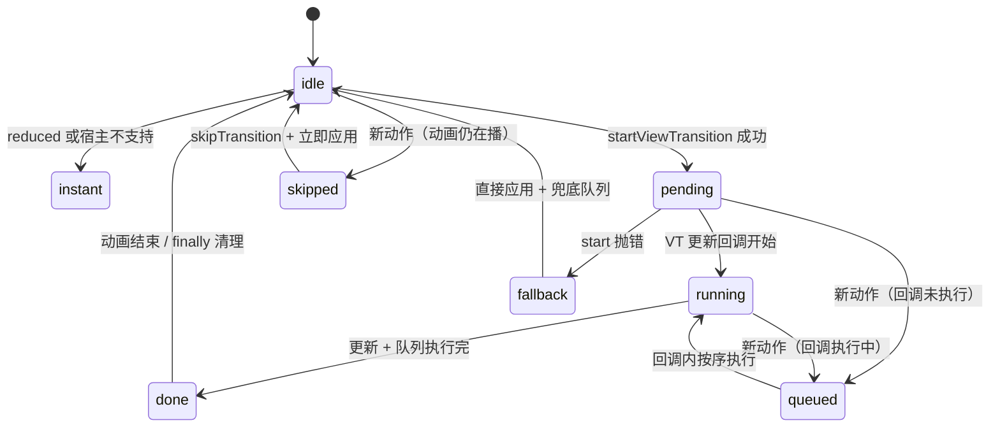
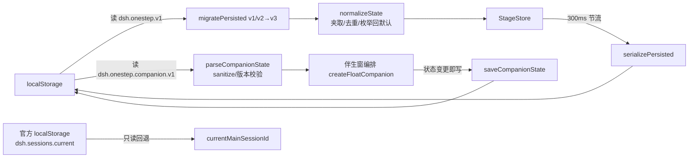

# 架构与实现原理

> **2026-11-20 本轮更新**：190/190 单测、构建一致性、i18n、版本范围、文档检查及发布自查已通过。当前 `client.js` 为 347283 B / SHA-256 `3B575E4DF04A4274FBF29FC0D43D33CD6804FEE19954DFAF48B813CC7F458148`。详见 [审查与优化记录](review/2026-11-20-review.md)。既有隔离 DSH 服务未运行，本轮未复跑实机端到端与安装演练；旧发布证据仍须重生成。

> 适用版本：**dsh-onestep 1.0.0**；基线 DSH Desktop **0.2.2-rc.1**。
> 本文面向想理解实现、参与维护、或在 DSH rc 升级时定位契约改动的读者。
> 相关文档：[README](../README.md) · [文档索引](./README.md) · [使用手册](./user-guide.md) · [兼容性与 rc 升级契约](./compatibility.md) · [发布前审查报告](./review/0.7.0-pre-release.md)

## 1. 交付形态与运行时分层

dsh-onestep 是一个 **持久客户端插件包**：不改 DSH 本体、不 patch 官方 bundle、不 fork。包内只有两个运行时代码文件，分别对应 DSH 插件的两半。

| 层 | 文件 | 形态 | 职责 |
|---|---|---|---|
| 宿主半（Node 侧） | `index.js` | ESM 模块，导出 `inject` 与 `apply(ctx)` | 只做「装载事实」探针：记录 apply/dispose 生命周期，不注册任何面向用户的能力 |
| 浏览器半（页面侧） | `client.js` | CJS bundle，由 `scripts/build.mjs` 从 `src/client/**` 生成 | 全部产品能力：舞台、窗口、候场、伴生浮窗、动效、持久化 |
| 浏览器半源码 | `src/client/**` | ES 模块 | 见 §11 模块职责表 |
| profile 挂载 | `cordis.patch.yml` | bundle patch | 把本包 `insert` 进 profile 的 loader 树 |

几个关键事实：

- **宿主半没有业务逻辑**。`apply` 有一个幂等守卫（同一 fiber 重复 apply 时跳过），并用 `ctx.effect` 注册 dispose；生命周期事件只写 console，只有在 patch 配置 `probeLog` 或环境变量 `ONESTEP_P0_LOG` 存在时才追加 JSONL 文件。这让「插件确实被宿主装载/卸载」有宿主侧一手日志，而无需改动任何界面。
- **浏览器半的产物形状由宿主 loader 决定**：顶层必须是 `window.__ModuleLoader__.load({ id: 'dsh-onestep', factory(require) { ... } })`，`id` 必须等于包名；`factory` 的返回值就是 Cordis 插件对象（`{ inject, apply }`）。所有副作用都发生在 `factory` 执行与 `apply` 内。
- **构建可逐字节复现**：`scripts/build.mjs` 把 esbuild 固定为 `cjs` / `chrome120` / 不压缩 / 11 项宿主模块 external，并在产物外包一层 loader banner/footer。2026-11-19 历史审查产物为 `client.js` **324696 B / sha256 `CC3D0F1C11A7C790B993677F61DB8117DB741DA345B577D751AC566D6FF76993`**；同一命令重复构建得到同一哈希。
- **发布包白名单**：`package.json` 的 `files` 只有 5 项，加上 `package.json` 自身构成 6 文件 tarball（`dsh-onestep-1.0.0.tgz`，**101808 B / sha256 `0B9C8D57F37560DEDDCE1ABB298159668E6B97CF107365B04F96BF0EDF5516BF`**）。



## 2. 插槽注入与自声明子槽

舞台不是「另开一个页面」，而是**接管官方会话主区的渲染位**，再把一个窗口合成系统挂进去。

### 2.1 注入点

| 注入点 | 注册形态 | 作用 | 何时注册 |
|---|---|---|---|
| `main` | keyed，`key: 'conversation'`，root 作用域，`priority: -1` | 覆盖官方会话主区（官方同 keyed 行 priority 为 0，低值胜） | 候场非空（进入舞台）时注册；候场清空即 dispose，官方主区恢复 |
| `onestep.focus` | single / `session-maybe`，声明为 `main` 注册项的 `children` | 主绑定桥：只上报当前主会话 ID，不渲染内容（`FocusBridge`） | 随 `main` 注册 |
| `onestep.window` | single / `session`，声明为 `main` 的 `children` | 每个窗口的内容槽（焦点窗与候场窗共用同一槽，每个窗口各自显式 `SessionProvider`） | 随 `main` 注册 |
| `conversation.session.header.actions` | list / session | 普通模式会话 header 的「舞台」入口（打开候选选择浮层） | `apply` 时经 `slots.inject` 等待声明后注册 |
| `sidebar.workspaces.session.row.action` | list / root | 侧栏会话行的「加入舞台」按钮 | 同上 |
| `shell.overlay` | list / root | 拖拽 HUD、候选选择浮层、状态边沿检测、全局 toast、右缘标签层、可选探针面板 | 同上，按 `order` 分层 |

官方内容渲染只经由一个 Component Factory：**`conversation.content`（variant `embedded`）**。每个窗口在外层 `SessionProvider` 绑定会话引用后调用 `renderFactorySlot('conversation.content', { variant: 'embedded', phase, hero }, { slots: { views: FixedChatView } })`；`FixedChatView` 再 `renderSlot('conversation.session', { view: 'chat' })`。这样聊天体、composer、审批/计划、队列等官方能力都被原样复用，插件只替换「窗口」与「布局」。

### 2.2 自声明子槽的规则

- DSH 的插槽语义是 **声明即独占渲染权**：`children` 里的槽只能由声明者的 `renderSlot` 渲染，一个槽只有一个声明者。官方已经声明过的子槽（如 `main.conversation`）第三方不能重复声明，因此插件在 `main` 注册项上 **自声明** `onestep.focus` / `onestep.window` 两个自己的子槽，再由自己的组件渲染。
- `main` 是 root 作用域，拿不到 `sessionId`；窗口级会话上下文只能通过自声明子槽 + 显式 `SessionProvider` 获得。`onestep.focus` 用 `session-maybe`（可能是会话，也可能为空），正好用于「主绑定还没有/正在切换」的桥接。
- 注册是「按声明等待」的：`ctx.slots.inject(name, cb)` 在槽声明可用时执行 `cb`，声明塌陷/重声明时自动清理并重跑。插件因此在 `main` 未声明时只把 `mainReady` 置 true 并尝试挂载；挂载失败不会清空用户的候场状态（`mountStage` 捕获异常、逆序 dispose、保留 roster 以便重试）。



## 3. 焦点 + 候场窗口模型与 sessions 引用管理

### 3.1 窗口模型

舞台的窗口数是 **1 个焦点窗 + 最多 12 个候场窗**。焦点是唯一的「当前主会话」，候场是同一会话界面内并排/堆叠的其它会话窗口。

- **焦点不存进 StageStore**。焦点永远派生自 DSH 的主绑定：官方 `openSession` 改变主绑定 → `main` 的 session-maybe 座位产生新会话 → `FocusBridge` 把 sessionId 上报给 `focusSignal`。当桥尚未上报（例如舞台刚挂载）时，插件用两个只读回退推断当前主绑定：目录行上的 `retainedBy.mainView` 计数，以及官方 localStorage 键 `dsh.sessions.current`（只读、不写回）。
- **候场 roster 存在 StageStore**：`{ sessionId, addedAt, lastFocusedAt }` 数组，新加入者插到头部，顺序即候场栏顺序；超过 12 个按 `lastFocusedAt` 最久未用淘汰（LRU）。目录 reconcile 会删掉已不存在的会话、把新焦点移出候场、把旧焦点插回候场头部。
- **每个窗口的 DOM 都由“外壳 + 官方内容”组成**：外壳负责几何、chrome、状态点、关闭/提升按钮、拖拽命中；内容是显式 `SessionProvider` 包住的 `onestep.window` 渲染位。候选列表重排不会重挂同一会话的卡片（key 为 sessionId）；焦点↔候场切换时窗口外壳与内容槽实例不同，occurrence 包装节点会重建，但会话引用保持、内容状态不丢（见 §3.2）。
- 焦点窗 `interactive=true`；候场窗内容包在 `inert` 中、以点击面提升为焦点。这保证同一会话在页面上只有一个可编辑 composer（DSH 的 Lexical 编辑器约束），也避免后台窗口误抢输入。

### 3.2 sessions 引用管理

DSH 的会话内容不是随时可渲染的：每个窗口必须持有一个 `sessions.retain(id, { source: 'onestepStage' })` 引用，把引用传给 `SessionProvider`；最后一个引用释放时，DSH 会拆除该会话的 scope/generation。引用数必须与窗口数严格对应。

插件的 `refs` 是一张 `Map<sessionId, SessionReference>`，规则如下：

1. **retain 集合 = 焦点 + 全部候场**。每次焦点上报、候场增删、目录 reconcile 之后调用 `syncRefs()`：先补齐期望集合中缺失的 retain。
2. **释放延后一个微任务**。换焦瞬间，旧焦点会短暂不在“期望集合”里（它还没被降级写回候场）。如果立刻 `release`，引用计数归零会让 DSH 同步拆除并重建 scope/generation，滚动位置与输入草稿有丢失风险。因此 `syncRefs` 只安排一次微任务，在微任务里**重新计算**期望集合后再释放确实不再需要的引用。
3. **换焦的“移出新焦点 + 降级旧焦点”合并为一次 store 提交**。如果分两次提交，当目标恰好是唯一候场时会出现 `candidates=[]` 的中间态，触发整舞台卸载再重挂载；合并提交后不产生这个中间态。
4. **主绑定抖动有宽限**。桥可能先上报一帧 null 再上报真实会话；`applyFocusReport(null)` 会启动 1.5s 定时器，期间主绑定到达则取消，否则退出舞台并释放引用。
5. **卸载后禁止再动引用**。dispose 时先置 `refsClosed`，排队中的微任务直接返回，再 `releaseAll()`。



### 3.3 关闭与撤销语义

- 关闭候场窗 = **移出舞台，不删除会话**。移除记录压入撤销栈，`Ctrl+Alt+Z` 可在 5s 内按原位置插回。
- 关闭焦点窗 = 提升候场头部为焦点，被关会话回官方左栏；此时抑制“旧焦点自动降级”，并用 `toast` 提供撤销。若候场为空则退出舞台。
- 关闭最后一个窗口 = 退出舞台（等效清空候场 roster，`main` 注册 dispose，官方会话界面恢复）。
- 舞台退出后把 DOM 焦点送回官方 composer（仅当焦点仍在舞台内或 body 上时才移动，避免抢用户正在别处的输入）。

## 4. 舞台几何与响应式

### 4.1 舞台根定位

舞台根不是 `absolute; inset: 0`（那会覆盖官方左栏），而是**按 main 列宿主矩形 fixed 定位**：

1. 从舞台根元素向上找第一个「真实盒子」祖先（跳过 `display: contents` 包装层，其 rect 为 0），记下 `left/top/width/height`；
2. `ResizeObserver` 观察该宿主与舞台自身，窗口 resize 也触发重测；
3. 宿主矩形就绪前舞台保持隐藏（`visibility: hidden`），就绪后才写入几何并置 `data-ready="1"`（进场动画只在真实几何上播放，避免 0×0 状态下播放）。

这样官方左栏折叠/右栏挤入/窗口缩放时，舞台始终落在 main 列内。

### 4.2 布局求解（纯函数）

`src/client/layout.js` 的 `solve()` 不依赖 React/DOM，只做几何：

```
输入：容器 width/height、railSide('left'|'top')、railSize、railCollapsed、候场数 count、可选最小尺寸
输出：focus 矩形、cards[] 矩形、rail 矩形、scroll 标志、degraded、实际 railSize、visibleCount、contentW/contentH
```

要点：

- **候场卡固定 √2:1**。左栏卡宽随候场栏宽、高 = 宽/√2；顶部卡高取 `min(栏高, 108)`、宽 = 高×√2。
- **先保证焦点窗最小尺寸，再压缩候场栏/卡片**。候场卡的设计最小尺寸为 200×108；低于该尺寸时布局进入 `scroll` 语义：候场 >3 且低于可读尺寸时**保持固定可读卡尺寸**，左栏纵向/顶部横向滚动（`contentW/contentH` 表示内容总长，`visibleCount` 表示当前布局下能完整放下的卡数）。
- 容器不足（宽 < 舞台最小宽度或高 < 焦点最小高度）返回单窗降级结果，由上层决定退出舞台。
- `layoutUsable()` 是「是否还能维持舞台」的判定；用户主动收起候场栏时返回的 `rail-collapsed` 属于正常折叠态，不算单窗降级，不能误触发退出。

### 4.3 响应式与降级

| 视口/容器条件 | 行为 |
|---|---|
| 舞台宽 ≥ 1080 | 候场栏默认左侧；用户可手动切到顶部 |
| 760 ≤ 舞台宽 < 1080 | 候场栏默认顶部 |
| 舞台宽 < 760（且右栏未展开挤压） | 400ms 去抖后退出舞台并 toast「窗口过窄」 |
| 右栏展开把 main 列挤到 < 760 | **compact 保活**：最小宽度阈值下探到 480，强制隐藏候场栏、只显示焦点窗；右栏收起后自动恢复 |
| 右栏展开且 main 列 < 480 | 同样按过窄处理退出舞台 |

其它响应式行为：

- **候场栏比例（0.7.0 起自由尺寸）**：8px 分割线可指针拖动（rAF 合并提交，每帧最多一次 store 更新）；键盘可用 ↑↓/←→ 每次 8px、Shift 24px、Home 到最小值、End 到当前舞台最大可用值；只保留下限 `railLeft: 200（默认 232）` / `railTop: 108（默认 132）`，**无固定上限**——求解时上限由焦点窗最小尺寸动态决定（`width/height - inset - gap - focusMin`），超宽/超高值在该分支自动收窄。
- **收起候场栏**：收起后只剩 40px 边条，显示各候场状态点与序号；手柄是原生按钮（`aria-expanded`），状态持久化。收起态边条被抬到焦点窗之上，避免被焦点窗覆盖。
- **候场滚动**：超出可视容量时滚轮只在指针位于候场栏内时拦截；候场栏底部提供「上一组/下一组」翻页按钮（键盘可达）。滚动位置不持久化，刷新回到顶部。
- **焦点窗最小尺寸**：480×320；候场卡最小 200×108。
- 舞台切到顶部栏时，焦点窗高度扣除栏高与间距；切到左栏时宽度扣除栏宽、8px 分隔与间距。

## 5. 候场卡：静态快照与自动精简

### 5.1 静态快照（live 档）

候场卡默认不再持续渲染官方聊天体，而是**渲染一次后克隆成静态画面**（0.7.0 用户要求：「完整后场的缩略改成静态图片，只有在状态改变时才更新」）：

- **快照管线**（`preview-cache.js` + `CandidatePreview`）：在卡内隐藏宿主挂载官方 `conversation.content` occurrence（`visibility:hidden`，仍参与布局）→ 等 `[data-conversation-content]` 有尺寸 → 再等 `innerHTML` 长度稳定（约 220ms 两拍，避免拍到空白壳/未补全历史）→ 克隆进缓存 → **立刻卸载隐藏 occurrence**。卡片之后只渲染静态 HTML，不再持有官方内容订阅、事件或 live 聊天体。
- **尺寸（contain）**：快照按固定逻辑宽（560–720px）渲染；展示时用 `fitSnapshot` 取 `min(内容盒宽/快照宽, 内容盒高/快照高)` 等比缩放并居中，**整张快照始终完整可见**（比例不一致时留白，不裁切）；卡片/候场栏尺寸变化只缩放快照，不重排、不重拍。内容盒已扣除卡片 1px 边框与 chrome 高度。
- **更新条件**：状态签名 `previewStatusKey` = `blank / awaitingFirstTurn / displayTitle / running / completionUnread / pendingInteraction.kind`。签名不变就不重拍——流式输出、相对时间变化不会更新画面；完成/待处理/标题变化时才重拍。新快照完成前旧快照继续展示。
- **调度**：`createCaptureScheduler` 串行 + 空闲启动，一次只挂载一张官方内容、间隔 140ms，避免多张同帧挂载叠加长任务；换焦动画期间（`deferredLiveIds`）先显示精简卡或旧快照。
- **已知成本**：首次预览与状态变化各需要一次官方内容挂载（约 0.15–0.4s/卡，串行），抓取完成前显示精简卡；滚动/拖宽/悬停/换焦期间不再发生挂载。快照是静态 DOM 克隆而非位图。
- 状态反馈：候场会话完成未读 → 卡边框双脉冲闪烁（2×600ms，`data-flash` 自清）；等待批准/回答/计划确认 → 卡底部的琥珀色气泡，点击气泡提升为焦点；`aria-live` 播报。

### 5.2 精简卡（card）

- 档位由 `previewMode`（`live` = 静态快照 | `card` = 精简卡）控制，用户可在焦点窗「…」菜单手动切换并持久化。
- 精简卡显示标题、状态、最近提问相对时间与「点击提升」提示，不挂官方聊天体，开销最低。
- **生效档位 = 用户偏好 + 自动降级**：自动降级激活时只覆盖渲染结果（`effectivePreviewMode`），**不写回**用户保存的偏好；下次启动仍是用户选择的档位。

### 5.3 自动精简降级

自动降级只在**本次舞台会话**内生效，不持久化；退出舞台即重置。判定是纯函数，输入为采样指标：

| 阈值 | 默认值 | 含义 |
|---|---|---|
| `windows` | 4 | 降级判定要求窗口数 ≥ 4（1 焦点 + 3 候场），不足时返回 `below-window-threshold` |
| `firstFrameMs` | 900 | 进入舞台首帧耗时超过 4 窗进入预算 → 精简 |
| `longTaskTotalMs` | 400 | 进入窗口内 longtask 累计超过进入预算的一半 → 精简 |
| `memoryDeltaMB` | 200 | 进入后 JS 堆增量超过空闲预算 → 目标为极简档，当前回退到精简卡（`fallback=true`） |
| `minFps` / `lowFpsWindowMs` | 30 / 2000 | 连续 2s 帧率 <30fps 的极简档信号：识别并参与判定，但极简档尚未实现，同样回退到精简卡 |

判定优先级（从高到低）：`disabled`（开关关闭）→ `manual-override`（用户本次舞台内手动切过档，自动判定不再覆盖）→ `below-window-threshold` → `memory` → `sustained-low-fps` → `first-frame` → `long-task` → `within-budget`。

实现上采样来自 `performance.mark/measure`（`stage-enter`、`focus-switch` 等）、`PerformanceObserver('longtask')` 与 `performance.memory`（不可用时该项视为未采样）。结果通过 `autoLiteSignal` 传给 StageRoot，只影响渲染档位。

> **已知边界**：极简档（把候场收成状态条）为 v1.1 候选、当前未实现；`minimalEnabled` 保持关闭，内存/帧率信号回退到精简卡并在 `reason` 中保留原始信号。

## 6. 官方右栏浮窗管理

舞台模式下，官方右栏的文档/文件/浏览器/终端等 tab 默认在屏幕右侧独立浮窗打开，不挤窄焦点窗；点击浮窗外收起为右缘标签；也可以手动切回官方右栏的左右分屏形态。

### 6.1 适配分层

| 模块 | 职责 |
|---|---|
| `companion.js` 的 `createCompanion` | 只读官方服务：能力探测（tab kind）、`mounted` 跟随审计、写操作守卫（只允许焦点会话）、错误归一化 |
| `companion.js` 的 `createFloatCompanion` | 浮窗编排：读舞台/视口/panel/浮窗 DOM 回显，计算槽位、分配/满槽淘汰、对账、float/dock/focus |
| `float-layout.js` | 纯函数：槽位表、槽位分配、最近槽位映射、满槽淘汰候选、记录与 DOM 观测对账 |
| `float-state.js` | 插件自有的伴生窗状态：形态（float/split）、managed 浮窗元数据、peek/docked、全局 UI 偏好 |
| `float-resize.js` | 8 向边缘缩放把手与手势、矩形提交、失败回退与预览还原 |
| `peek-layer.js` / `peek-tags.js` | 收起注入、MutationObserver 重放、右缘标签层与整堆拖动 |

**权威划分**：官方是浮窗矩形、tab 记录、右栏展开态与布局的权威持久层；插件只存「形态 + 槽位映射 + peek + docked + managed 元数据」。插件从不写官方持久化键。

### 6.2 打开重定向（非公开扩展点之一）

官方没有「重定向打开目标」的扩展点，所有顶层打开都硬编码调用 `ctx.sidebarRight.openResource(...)` / `openTab(...)`。插件在运行时包装实例上的这两个 own property 方法：

1. 能力自检：`openResource/openTab/active/isExpanded/toggleExpanded/focus/float/dock` 等实例成员必须存在；不满足则不包装、只日志，官方右栏行为不变。
2. 包装只对「没有显式放置意图」的调用生效：调用方传了 `destination/paneId/preferNewPane/replaceTab` 任一字段即直通；右栏已展开时也直通（尊重用户手动展开的右栏）。
3. 重定向算法：`original.apply(svc, args)`（官方错误原样抛）→ **在 `float()` 之前** `svc.active()` 取 tabId（`float` 之后的 active 可能被官方 settle 补种的 guide 抢走）→ 已被管理时：若该浮窗处于**收起态**则由 policy 的 `onRevealManaged(record)` 走单窗恢复（清除 peek/inert/transform、更新状态、聚焦内容，不再重复 focus），未收起则先由 policy 的 `onFocusManaged(record)` 高亮闪烁两下（纯 CSS 标记，不改官方状态），再 `focus` 抬升到最上层 → 否则分配槽位并 `svc.float(tabId, rect)` → 若本次打开把右栏展开了则 `toggleExpanded()` 收起。
4. 包装自身的后续步骤失败只记日志、结果留在官方右栏；卸载时校验「当前方法仍是我们的 wrapper」再 `delete` 还原，避免抹掉其它插件的包装。

### 6.3 槽位与满槽策略

槽位矩形是 **viewport CSS 像素**，直接交给官方 `float(tabId, rect)`：

```
slotW = clamp(340, 舞台宽 × 0.3, 480)      // 340–480px
slots = 从舞台右缘向左排，间距 8，四周留白 16
maxSlots = min(3, 能完整放下的槽位数)；窄屏（视口 <900 或舞台宽 <760）强制 1 槽
slot[0] = 最右（第一个浮窗），slot[1] 在其左侧 …
```

- 满槽时先收起**最久未聚焦且未收起**的浮窗（DOM + 状态），新窗复用其槽位；被收起的浮窗内容不丢，可随时恢复。
- 对账（reconcile）：把插件记录与 DOM 实际观测到的浮窗合并——仍在 DOM 的更新 paneId/标题/矩形/peek 态；不在 DOM 且未 docked 的删除；docked 记录只在官方 tab 仍打开时保留；DOM 里存在但插件没记录的「未管理浮窗」不接管、不纳入 peek。
- 形态：`float`（默认，独立浮窗）与 `split`（逐个 `dock` 回官方右栏）；「转回浮窗」按槽位分批恢复，槽位不足时其余保持收回右栏并 toast 提示，不制造重叠。

### 6.4 8 向边缘缩放（非公开扩展点之三）

官方浮窗只有右下角一个缩放角，且服务面没有编程 move/resize。插件自绘 8 个透明把手（左右上下边 6px、四角 12px，压在浮窗边缘），手势在浮窗元素捕获阶段抢占：

- 实时预览：只写浮窗元素的内联 `left/top/width/height` 并加 `data-onestep-resizing` 标记，不改官方状态；Esc 取消并还原；只点一下边缘（无位移）不提交，避免污染官方撤销历史。
- 几何约束镜像官方口径：最小 **220×140**；西/北侧拖动时对边固定；东/南侧受视口限制；北侧不低于标题栏下沿（`caption + 20`，全屏时 caption 取 0）。
- 提交：优先沿官方浮窗的 React fiber 读取组件 props 上的 `intents.resizeFloat`（与官方手势同一提交入口），调用一次即由官方 store 记录 `resizeFloat`（可撤销、持久化、重渲染）；取不到 intents 时回退官方 controller 的 `actionsFor(sessionId).resizeFloat`；两者都不可用则**只还原预览并记日志，不改变官方状态**。
- 仅在「舞台激活 + float 形态」接管当前会话 panel 内的官方浮窗；split/普通模式不注入任何把手。

```mermaid
sequenceDiagram
  autonumber
  participant L as 官方打开入口/链接
  participant W as service-wrap
  participant S as sidebarRight 实例
  participant F as createFloatCompanion
  participant ST as float-state

  L->>W: openResource / openTab（无显式 placement）
  W->>S: original.apply
  W->>S: active()（float 前取 tabId）
  alt 已管理
    opt 该浮窗已收起
      W->>ST: onRevealManaged 单窗展开
      W->>S: 恢复可见 + focus(tabId)
    else 仍可见
      W->>S: focus(tabId)
    end
  else 未管理
    W->>F: allocate(当前 managed 浮窗)
    F-->>W: slot + rect（满槽则 evict 最久未聚焦）
    W->>S: float(tabId, rect)
    opt 本次打开导致右栏展开
      W->>S: toggleExpanded() 收起
    end
    W->>ST: onManaged 记录 managed 元数据
  end
  Note over W: 后续步骤失败只记日志，结果留在官方右栏
```

### 6.5 收起标签层（非公开扩展点之二）

官方没有「移出视口但保留」的 API（`hide()` 对浮窗等于关闭并丢内容状态），因此收起 = 对官方浮窗元素做**可见性注入**：

- 属性：`data-onestep-peek="1"`；
- 内联样式：`transform: translateX(calc(100vw + 24px)) !important`（用视口宽而非自身宽，任意槽位都能移出右缘）、`pointer-events: none !important`；
- 可访问性：`inert` + `aria-hidden="true"`；
- 恢复：移除上述注入；带 180ms transform 过渡（reduced motion 时直切），并临时加 `data-onestep-peek-restoring` 保住过渡规则，动画结束再清。

官方 re-render 可能重写 `inert`/`aria-hidden`，所以注入不是一次性的：只在存在收起项时开启 `MutationObserver`，按 tabId 重放；注入前做幂等判定（peek 属性、transform、inert、aria-hidden 齐备即返回），并过滤自身对已收起元素的属性写入，避免「observer → rAF → 再注入」的自触发循环。

右缘标签层是 `createPortal` 到 `document.body` 的 fixed 堆叠按钮层（z 63：高于浮窗层 60、低于官方菜单），每个标签是原生 `button`（`aria-expanded`/`aria-controls` 指向浮窗元素）：

- 点击标签只恢复该浮窗，并把焦点送进恢复后的内容；
- 点击浮窗外（且不在标签层/官方菜单/浮层内，位于舞台区域）→ 收起当前会话全部可见浮窗；
- **整堆拖动**：在任意标签上按下并上下移动 ≥4px 即拖动整堆（移动后抑制本次 click，点击语义不变）；松手在 10px 阈值内吸附到上沿/下沿/默认安全位置；顶部保留专用手柄（指针拖动 / ↑↓ 8px / Shift 24px / Home/End），位置按全局 UI 偏好持久化（`ui.peekTop`）；标签层始终贴右缘，拖动只改纵向。

## 7. View Transitions 动效体系

### 7.1 单一源与路由

`src/client/motion.js` 是动效的**唯一常量源**：时长/距离/缩放/曲线、每种几何变化的组时长与快照交叉参数（`MOTION_KINDS`）、以及从 `MOTION` 插值出的 `:root` CSS 变量（`--onestep-*`）。`styles.js` 只引用这些变量，其它模块不再写裸时长/曲线字面量。

舞台内几何变化统一走 `stageMotion(kind, update)`：

| kind | 触发 |
|---|---|
| `promote` / `promoteClick` | 焦点↔候场提升/降级（键盘/点击慢速路径） |
| `rail` | 候场栏收起/展开 |
| `evict` / `add` / `close` | 候场移除/加入/关闭 |

`run(update, opts)` 的路由规则（实测约束：`startViewTransition` 之后同步改 DOM 会并入旧快照，所以真实更新必须在 VT 更新回调里执行）：

- 减少动效或宿主不支持 `document.startViewTransition` → **直切**（`instant`），只执行更新；
- 已有过渡处于「已启动、更新回调未执行/执行中」→ 更新**排队**（`queued`），在 VT 回调内按调用顺序执行，避免状态顺序颠倒；
- 已有过渡处于「回调已完成、动画仍在播」→ `skipTransition` 后立即应用（`skipped`）；
- `startViewTransition` 抛错 → 清变量/覆盖后直接应用（`fallback`），并兜底执行回调与队列。

每次过渡结束都会清理：`--onestep-vt-*` 变量、方向性快照覆盖、临时给官方浮窗/标签注入的 `view-transition-name`。

### 7.2 方向性快照与防闪

提升/降级同时改变两个窗口的尺寸，VT 默认交叉会出两类残影：

- 被提升窗口的旧快照是候场缩略图，若随 group 放大到焦点尺寸会盖住邻窗 → 旧快照 1ms 隐藏、新内容立即淡入；
- 被降级窗口的新快照是候场卡，若在焦点尺寸下淡入会形成「放大的卡片鬼影」→ 新快照延迟 150ms 再出现、淡入持续 80ms，等 group 收拢后再出现；
- 页面根快照的交叉淡化会让侧栏等非窗口区域出现双影 → `::view-transition-old(root)` 立即隐藏、`::view-transition-new(root)` 立即可见，命名窗口仍按快照动画。

morph 曲线使用 `cubic-bezier(0.22,1,0.36,1)`（快出慢收）。浮窗与右缘标签在 morph 前会被临时赋予 `view-transition-name`，避免被窗口快照盖住；结束后逐个还原原值。

### 7.3 点击换焦的慢速占位路径

真实鼠标点击候场卡（`event.detail > 0`）时，需要「点击后立即开始动画、官方聊天体在动画期间完成重挂载」：

1. 先设 `focusPreviewSignal` 为目标会话，焦点窗渲染**轻量占位内容**（标题/状态 + 骨架，不挂官方聊天体）；
2. 在 VT 更新回调内提交焦点状态（占位）并让出两个任务，动画随即开始；
3. 动画期间调用官方 `openSession` 完成主绑定切换；
4. `onReady` 清除占位，真实聊天体在动画结束前后可见（VT 快照是静态图，无法在动画中途替换）。

该路径需要「目标已 retain、VT 可用、当前无进行中过渡、非 reduced motion」，否则回退标准 220ms morph；带 1600ms 兜底定时器防止占位卡死。键盘激活（Enter/Space 或 `.click()`，`detail=0`）仍走标准 morph。

### 7.4 其它动效与减少动效

- 舞台进场 260ms（淡入 + 焦点窗 `scale(0.98→1)` + 候场栏侧向滑入，只动 opacity/transform）；
- 完成闪烁 2×600ms、气泡收起 120ms、toast 进场 160ms、覆盖层/菜单 120–160ms、拖拽 HUD 140ms；
- 不自动播放循环动画（状态点是颜色/形状/文案的静态表达）；
- **减少动效双路径**：系统 `prefers-reduced-motion` 或插件设置「减少动效」生效时，`<html data-onestep-motion="reduced">` + CSS 变量归零/动画 none，同时 JS 侧跳过 VT（直切）；设置持久化在舞台状态里。



## 8. 持久化模型

插件只使用两个自有 localStorage 键（外加一个探针开关），并且**只读**一处官方 localStorage。

| 键 | 版本 | 内容 | 写入策略 |
|---|---|---|---|
| `dsh.onestep.v1` | 3 | 候场 roster（sessionId/addedAt/lastFocusedAt）、railSide、railSize、railCollapsed、previewMode、autoLite、persistStage、reducedMotion | 300ms 节流写入；dispose 时 flush |
| `dsh.onestep.companion.v1` | 1 | `bySession`（每会话形态 float/split + managed 浮窗数组）、`ui.peekTop` | 每次状态变更即写；坏 JSON/版本不符/字段漂移一律回默认 |
| `dsh.onestep.probe` | — | 是否渲染可选探针面板的本地开关 | 用户/验证器显式设置 |

只读官方键：

- `dsh.sessions.current`：仅用于舞台未挂载时推断主绑定会话（解析失败即忽略，不写回）。
- 官方浮窗布局键（`dsh.sidebar-right.v1.<sessionId>`）是官方右栏的权威持久层，插件**不读也不写**；浮窗对账走 DOM 回显（`data-dockkit-*` / `data-sidebar-right-*`），不依赖官方存储内容。

版本迁移与规范化：

- `dsh.onestep.v1` 的 v1/v2 负载会被迁移到 v3（保留 roster 与布局设置，`previewMode` 统一迁移为 `live`）；版本不符或无法解析直接回默认，不抛错。
- 所有读取都先过 `normalizeState`：railSide 归一、railSize 只夹下限（0.7.0 起不设上限，非法/非有限值回默认）、候选去重/截断到 12、枚举回默认；坏存储不会让插件崩溃。
- `persistStage=false`（「重启不恢复舞台」）时**仍写入该设置本身**，但候场 roster 写空，避免下次启动按旧快照恢复舞台。
- 浮窗状态按会话隔离，单会话最多记录 8 条浮窗元数据（防御坏存储）；`peek` 不跨刷新（载入时一律恢复为可见），形态保留。
- 不写任何会话内容、不写凭据；日志与持久化都不包含正文。



## 9. 能力探测与降级矩阵

`apply` 的第一件事是能力探测（`detectCapabilities`）：`ctx.slots.register/inject` 不可用时插件**直接返回**，不注册任何东西；`inject = ['slots','locale','shortcuts']` 是三个必需服务，缺失时 Cordis 层保持插件 pending、不 apply。可选服务（`sessions` / `uiWorkspace` / `sidebarRight`）依赖 Cordis 激活顺序，一律惰性 `ctx.get` 并在使用点降级，不在启动时硬拦。

| 条件 | 检测点 | 行为 | 可观测日志 |
|---|---|---|---|
| 缺插槽能力 | `detectCapabilities` | 不激活任何功能，直接 return | `capability.missing` |
| 缺必需服务（slots/locale/shortcuts） | `inject` | 插件保持 pending、不 apply，不阻塞其它插件 | boot 中无 `apply` 日志 |
| `sessions` 缺失/未就绪 | 惰性 `ctx.get` + 目录订阅 | 不能 retain/渲染窗口；保留状态，等 `ctx.inject(['sessions'])` 就绪后重试 | `sessions.missing` / `sessions.subscribe.error` |
| `uiWorkspace` 缺失 | `openSession`/`startSession` 调用点 | 换焦/快速新建不可用并记日志，其余功能继续 | `focus.error` / `quickNew.error` |
| `main` 槽未声明 | `slots.inject(main)` 回调 | 延迟挂载：保留 roster，等声明后 `syncStage()` 重试 | `stage.mount.deferred` / `main.declared` |
| 舞台注册抛错/槽冲突 | `mountStage` try/catch | 逆序 dispose 已注册项 → toast「舞台暂时不可用」→ **保留 candidates** 以便重试 | `stage.mount.error` |
| 窗口内容渲染崩溃 | 每窗 `WindowErrorBoundary` | 该窗降级为错误提示，其它窗口与舞台不受影响；槽运行时崩溃会让官方 occupant 自动回归 | `window.error` |
| locale 注册/绑定失败 | `installLocale` / `locale.bind` | 文案退化到内置中文回退，其余功能正常 | `locale.register.error` / `locale.bind.error` |
| 快捷键注册失败/冲突 | 每个 `shortcuts.register` 包 try/catch | 该命令不生效，不把异常抛进 registry；其它命令与插件不受影响 | `shortcut.register.error` / `shortcuts.missing` |
| `sidebarRight` 缺失/方法不全 | `checkWrapSupport` 能力自检 | 不安装包装层，官方右栏行为不变；浮窗相关功能不可用 | `wrap.install`（`ok:false` + `missing`） |
| 官方浮窗 DOM 缺失/选择器漂移 | 选择器探测 / `readFloats` | 不接管 peek/标签/缩放，官方浮窗原样；不阻塞官方 UI | `peek.observe.error` / `float.resize.sync.error` |
| fiber `intents.resizeFloat` 不可用 | `findFloatIntents` | 回退 controller `actionsFor().resizeFloat`；再失败只还原预览并日志 | `float.resize.commit.fail` |
| 官方 tab kind 缺失（如 web profile 无 `browser`） | tab registry `entries()` | 该 kind 的伴生窗不可用（返回 `kind-missing`），其余 kind 正常 | `companion.*.error` |
| View Transitions 不支持 | `typeof document.startViewTransition` | 所有动效直切，功能不受影响 | `motion.*.instant` |
| 用户/系统要求减少动效 | 设置 + `matchMedia` | 跳过 VT、CSS 动画归零、过渡直切 | `motion.*.instant`（`reduced`） |
| 无 localStorage | storage 探测失败 | 状态只存内存，本次会话可用；不抛错 | 持久化静默失败 |
| 视口过窄/右栏挤压 | StageRoot 布局可用性 + 400ms 去抖 | compact 保活或退出舞台并 toast | `stage.narrow` / `stage.exit` |
| 主绑定抖动（null 一帧） | `applyFocusReport` | 1.5s 宽限，期间主绑定到达则不退出 | `focus.report` 时间线 |

## 10. 卸载与清理

插件以「注册即随 fiber 清理」为原则：`ctx.effect` / `ctx.slots.register` / `ctx.slots.inject` 都挂在插件 fiber 上，卸载时由 Cordis 自动执行 disposer；插件在顶层再注册一个生命周期 effect 做产品态清理：

1. 取消目录订阅、store 订阅与 focus 订阅；
2. `unmountStage()`：清空焦点信号与定时器，把 `main`/`onestep.focus`/`onestep.window` 的 disposer 移入延迟队列，`setTimeout(0)` 等 React 本次提交完成后再销毁（避免「从已销毁注册中 renderSlot」报错）；若期间重新挂载，挂载开头同步冲刷队列；
3. 置 `refsClosed`，`refs.releaseAll()` 释放全部会话引用；
4. 还原所有收起注入（对每个 peeked 浮窗执行恢复），`peekLayer.dispose()`（停 observer/rAF/外部点击监听）；
5. `floatResize.dispose()`（移除把手、监听、内联样式，取消进行中的手势）；
6. 包装层通过 `ctx.inject(['sidebarRight'])` 的 scope effect 还原（校验后再 `delete`）；
7. 解除 `matchMedia` 监听、移除 `<html data-onestep-motion>` 属性；
8. `store.flush()` + `store.dispose()`、`feedback.dispose()`、`localeDispose()`、移除样式标签（样式标签的 disposer 在 `ctx.effect` 中）；
9. 删除 `window.__ONESTEP__`，写最后一条 `dispose` 日志；
10. 宿主半的 dispose 复位幂等守卫并记录 `host.dispose`。

卸载后不应残留插件 DOM、样式、全局变量或会话引用。发布前审查记录的少数低频清理项（诊断/测试路径）见[发布前审查报告](./review/0.7.0-pre-release.md)的未修复清单，不阻断 1.0.0。

## 11. 模块职责表（`src/client/**`）

| 模块 | 职责（一行） |
|---|---|
| `index.js` | 浏览器半入口：能力探测、locale/样式/快捷键注册、store/信号/引用管理、模式机（候场非空即挂载舞台）、入口与 overlay 注册、探针面、生命周期清理 |
| `adapter.js` | DSH 契约单一源：槽名/服务名/Factory/持久化键/限制常量/字段访问器/能力探测；rc 升级只改这里 |
| `stage-root.js` | 舞台根组件与主绑定桥：宿主矩形测量、布局求解调用、焦点窗/候场窗/候场栏/分割线/快速新建/菜单/状态渲染 |
| `store.js` | 舞台持久状态与纯函数变更（候选增删/对账/栏设置/预览档/动效偏好）、自动精简判定、节流持久化 |
| `layout.js` | 舞台几何纯函数：焦点/候场卡/候场栏矩形、滚动语义、断点建议、布局可用性判定 |
| `content.js` | 官方 `conversation.content` Factory occurrence 与单窗渲染错误边界 |
| `quick-new.js` | 官方草稿创建桥；正文只传给宿主，诊断只记录长度与工作区 ID；兼容同步与异步失败 |
| `status.js` | 会话状态归类与相对时间格式化（纯函数，组件与单测共用） |
| `feedback.js` | 瞬时反馈：完成闪烁、待处理气泡、aria-live 播报、5s 撤销、toast |
| `locale.js` | zh/en 文案字典（各 75 键）、状态→文案键映射、最小插值 |
| `styles.js` | 插件的 CSS 字符串：语义 token、窗口/候场/缩略、收起标签、缩放把手、reduced-motion 全覆盖 |
| `motion.js` | 动效常量单一源、`:root` 变量生成、View Transitions 控制器（串行/排队/跳过/直切/清理）、reduced-motion 判定 |
| `h.js` | React 元素简写（源码不使用 JSX，构建零配置） |
| `drag.js` | document 级拖拽捕获、落点 zone 判定、普通模式落点 HUD 组件 |
| `companion.js` | 官方右栏/浮窗适配层：能力快照、mounted 跟随审计、写操作守卫、槽位/对账/float/dock/focus 编排 |
| `float-layout.js` | 浮窗槽位计算、分配/满槽淘汰、矩形对账（纯函数） |
| `float-state.js` | 伴生窗插件自有状态（形态/managed/peek/docked/ui 偏好）的清洗、读写与查询 |
| `float-probe.js` | 浮窗原语只读探针桥（验证/诊断用，非生产路径） |
| `float-resize.js` | 8 向缩放把手与手势、几何约束、官方矩形提交与回退、预览还原 |
| `peek-layer.js` | 收起注入与还原、MutationObserver 重放、标签层数据控制器、外部点击收起 |
| `peek-tags.js` | 右缘标签层 React portal 组件与整堆拖动/吸附/键盘定位 |
| `service-wrap.js` | 官方 `sidebarRight.openResource/openTab` 的运行时包装、能力自检、让位与还原 |
| `probe.js` | `window.__ONESTEP__` 证据面、环形事件日志、可选探针面板 |

## 12. 构建与工程门禁

| 项 | 当前事实 |
|---|---|
| 构建 | `npm run build`；esbuild `cjs` / `chrome120` / 不压缩 / 11 项 external；当前产物与验证结果见 [本轮审查记录](review/2026-11-20-review.md) |
| 构建一致性 | `npm run build:check` 在内存构建并逐字节比较磁盘产物；缺失或过期即失败，检查不写盘 |
| 单测 | `npm test` 自动发现 `tests/*.test.mjs`；2026-11-20：190/190 通过 |
| i18n | `npm run i18n:check`：zh/en 各 75 键、键集一致、无硬编码、插值参数一致 |
| 语法 | `node --check client.js` 通过 |
| 契约集中度 | `npm run compat:inventory`：adapter 之外的外部契约字面量必须登记豁免，未登记即失败；adapter 单一源约定见[兼容性文档](./compatibility.md) |
| 打包 | `npm pack` 6 文件白名单；包内 `client.js` 哈希与仓库一致 |
| 证据 | 发布前审查与门禁结论见[发布前审查报告](./review/0.7.0-pre-release.md)、[发布证据索引](./release/evidence.md) |

## 13. 已知边界

- **非公开扩展点**：右栏浮窗与缩放依赖四类超出公开 API 的实现细节（包装官方打开入口、官方浮窗 DOM 注入、沿 React fiber 取 `intents.resizeFloat`、只读官方 localStorage）。每一类都有能力自检与回退，失败时退回官方行为而不是阻塞 DSH；逐类说明与 rc 升级核对清单见[兼容性文档](./compatibility.md)。
- **缩放无键盘等价路径**（与官方右下角缩放一致）；8 向缩放只覆盖当前会话 panel 内的官方浮窗。
- **浏览器 tab 仅在桌面 profile 可用**（官方按 profile 门控）；web/隔离 profile 按设计降级。
- **极简档（状态条收栏）为 v1.1 候选，当前未实现**；内存/帧率信号目前回退到精简卡。
- 候场滚动位置不持久化；`Ctrl+Alt+2…9` 只覆盖前 8 个候场，第 9 个起需滚动后点击或使用标题按钮提升。
- 舞台接管官方会话主区后，官方 header 的视图页签等能力不可复用，窗口 chrome 由插件自绘；切换官方左栏面板会整体卸载并重挂载舞台（切焦点不重挂载）。
- View Transitions 依赖 Chromium ≥111；不支持时自动直切，功能不受影响。外部主绑定切换（例如直接点官方左栏会话）无法在 DOM 变化前启动 VT，走直切。
- `window.__ONESTEP__` 在页面同源上下文始终暴露只读快照与动作接口（探针面板只由 localStorage 开关控制），排查问题时请自行脱敏。