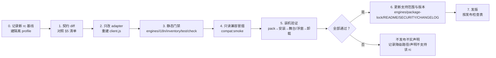

# 兼容性与 DSH rc 升级契约

> 适用版本：**dsh-onestep 0.7.0**；基线 DSH Desktop **0.2.2-rc.1**。
> 本文说明插件如何声明与 DSH 的版本关系、宿主契约集中在哪、用到哪些非公开扩展点，以及每次 DSH rc 发布后的升级核对流程。
> 相关文档：[README](../README.md) · [CHANGELOG](../CHANGELOG.md) · [SECURITY](../SECURITY.md) · [架构与实现原理](./architecture.md) · [发布检查表](./release/checklist.md) · [发布证据索引](./release/evidence.md) · [发布前审查报告](./review/0.7.0-pre-release.md)

## 1. 支持范围与基线

| 项 | 值 |
|---|---|
| 插件版本 | 0.7.0 |
| DSH 基线 | DSH Desktop **0.2.2-rc.1**（桌面 App 与 Web 端同源） |
| `engines.dsh` | `>=0.2.2-rc.1 <0.3.0-0 \|\| >=0.2.1-rc.5 <0.2.2-0` |
| 支持策略 | 跟随后续 rc：声明「当前最新 rc + 上一个 rc」，每次 rc 适配按 patch/minor 发布 |
| 契约集中点 | `src/client/adapter.js`（单一源，见 §3） |
| 升级入口 | 本文 §7 检查清单 + [发布检查表](./release/checklist.md) |

`engines.dsh` 是 OR range，两个分支分别表达：

- `>=0.2.2-rc.1 <0.3.0-0`：当前 rc 线（含未来 0.2.x 的 patch rc 前向容忍，上界只切 0.3 线）；
- `>=0.2.1-rc.5 <0.2.2-0`：上一个 rc。

版本判定样本（与 `npm run compat:engines` 的矩阵一致）：

| DSH 版本 | 是否接受 | 说明 |
|---|---|---|
| 0.2.2-rc.1 | ✅ | 基线，发布证据覆盖该版本 |
| 0.2.2 | ✅ | 同版本线的正式版，按契约预期兼容（正式版发布后需复核） |
| 0.2.1-rc.5 | ✅ | 上一 rc（声明支持；本发布证据只覆盖基线，补测见 §8） |
| 0.2.3-rc.1 | ✅ | 前向容忍：只切 0.3 线，不切 0.2 线内的 patch rc |
| 0.2.2-alpha.3 | ❌ | 低于 rc.1；且被 `<0.2.2-0` 排除 |
| 0.2.0-rc.1 | ❌ | 低于下界 |
| 0.3.0-rc.1 | ❌ | 被 `<0.3.0-0` 排除 |

## 2. engines 语义：includePrerelease 的坑

DSH 只发 rc（`-rc.N` 之类的预发布版本），这会让常规 npm semver 写法出现两个问题：

1. **单 range 表达不了两个 rc**。npm semver 默认规则是：带预发布的版本，只有在 range 里存在**同一 major.minor.patch tuple 的预发布比较器**时才可能满足。所以 `>=0.2.1-rc.5 <0.3.0` 不包含 `0.2.2-rc.1`（下界 tuple 是 0.2.1），而 `>=0.2.2-rc.1 <0.3.0` 也不包含上一个 rc。OR range 是同时表达「最新 rc + 上一 rc」的唯一单字段写法。
2. **上界会 fail-open**。DSH 在 boot 侧用 `semver.satisfies(runtime, range, { includePrerelease: true })` 判定 `engines.dsh`（0.2.2-rc.1 `app-boot` 源码；发布前审查已核对），预发布版本直接参与比较、不套用上面的默认 tuple 规则。此时上界若写 `<0.3.0`，`0.3.0-rc.1` 也满足（`rc.1` 小于正式版 `0.3.0`）；同理 `<0.2.2` 会放行 `0.2.2-alpha.*`。

因此上界写成 **`<0.3.0-0` / `<0.2.2-0`**：`-0` 是 semver 中最小的预发布标识符，`X.Y.Z-0` 小于 `X.Y.Z` 的任意预发布版本，从而把该 tuple 的 alpha/beta/rc 全部挡在外面。下界保留 `>=0.2.2-rc.1`，明确从基线 rc 开始接受。

配套约束：

- **门禁必须与宿主同语义**。`scripts/p2/compat/check-engines.mjs` 用零依赖的最小 semver 子集实现「预发布直接参与比较」，并把「已声明支持 / 必须排除 / 前向容忍」写成矩阵逐项断言；不能用 npm 默认 prerelease 规则去校验，否则会把 fail-open 误判成已拦截。
- **同一字符串必须同步**：`package.json` 的 `engines.dsh`、`package-lock.json` 根包的 `engines.dsh`、README 与 SECURITY 的支持范围说明。改一处必须全部同步。
- **不锁死单个 rc**。每次 rc 适配后更新区间与矩阵，按 patch/minor 发版；不要用 `~`/`^` 或固定版本表达。

## 3. adapter 单一源约定

DSH 的公开 API 仍处于 pre-stable：插槽名、服务方法、数据结构字段、Factory 参数都可能随 rc 漂移。插件把这些「外部契约」集中在 **`src/client/adapter.js`**，其余模块只引用常量或纯函数。

当前 adapter 导出的契约面：

| 导出 | 内容 |
|---|---|
| `SLOTS` | `main` / `mainKey` / `window` / `focus` / `headerActions` / `rowAction` / `overlay` |
| `SERVICES` | `sessions` / `uiWorkspace` / `sidebarRight` / `sidebarRightTabs` / `layout` / `locale` / `shortcuts` / `theme` |
| `INJECT` | 必需服务：`slots` / `locale` / `shortcuts` |
| `CONTENT_FACTORY` | Factory 名 `conversation.content` + variant `embedded` |
| `COMPANION` | 伴生窗持久化键、官方 DOM 选择器/属性、层序、默认尺寸与阈值 |
| `SESSION_FIELDS` | 会话字段访问器：title/blank/updatedAt/unread/running/pendingKind |
| `STORAGE_KEY` / `STATE_VERSION` / `PROBE_FLAG_KEY` | 插件持久化键与版本 |
| `LIMITS` | 舞台/候场/几何/撤销窗口等常量 |
| `detectCapabilities` / `sessionsById` / `statusOf` / `statusesSnapshot` | 能力探测与数据形态兼容访问器（状态 Map/对象双形态） |

约定：

1. **新增宿主依赖先改 adapter**：新增槽名、服务、字段、DOM 选择器或官方存储键时，先在 adapter 声明常量，再在功能模块引用；功能模块不得直接写契约字面量。
2. **DOM 弱契约允许，但必须登记并有回退**。官方拖拽协议（`data-row-key`、`dataTransfer text/plain`）、官方浮窗 DOM 属性（`data-dockkit-*`、`data-sidebar-right-*`）属于弱契约：允许在功能模块出现，但需在契约清单脚本的豁免表中逐条登记理由，并确认有兜底路径（选择器缺失时功能退化、官方 UI 不受影响）。
3. **数据 hooks 无法包装，只能集中字段语义**。组件 props 上的 `useSessions` / `useSessionStatus` 等只能由组件直接调用，因此 adapter 提供字段访问器与 `statusOf` 等纯函数，把「`useSessionStatus` 是 Map 而不是普通对象」这类最容易漂移的语义收在一处。
4. **静态门禁可复跑**：`npm run compat:inventory` 扫描 `src/client` 全部模块（先剥注释），把字符串字面量分类为 slot / service / factory / dom / storage-key / resource-scheme / status-enum / sidebar-tab-kind / shortcut / boot-global / dom-slot-marker 等，与 adapter 白名单比对：

   - 字面量出现在 adapter → 集中（centralized）；
   - 出现在其它模块但已在豁免表登记 → 豁免（exemptions，每条有理由，可标 `debt` 表示登记为技术债）；
   - 其余 → 违规（violations），退出码 1。

   报告同时记录 adapter 与全部被扫文件的 sha256，用于判断证据是否过期；`--strict` 用于债务收口后收紧门禁。

5. **rc 升级只改 adapter**。契约 diff 后先改 adapter 并重建 `client.js`，再跑门禁；不要在功能模块里散点修补。

## 4. 平台 external 模块（11 项）

浏览器半的 bundle 只能同步 `require` 宿主 platform 表中的 11 个 specifier；其余依赖必须打进 bundle 或不用。`scripts/build.mjs` 把这份表逐项列为 esbuild external，顺序与宿主一致：

| # | specifier | 说明 |
|---|---|---|
| 1 | `react` | 元素创建（`h.js` 用 `React.createElement`） |
| 2 | `react/jsx-runtime` | 宿主平台表成员（源码不使用 JSX，保留边界声明） |
| 3 | `react-dom` | `createPortal`：右缘收起标签层渲染到 `document.body` |
| 4 | `react-dom/client` | 宿主平台表成员 |
| 5 | `@deepseek-ai/cordis` | Cordis 插件运行时 |
| 6 | `zod` | 宿主 platform 表成员 |
| 7 | `@tanstack/react-virtual` | 宿主 platform 表成员 |
| 8 | `@deepseek-ai/dsh-client-store` | 宿主 store 契约 |
| 9 | `@deepseek-ai/dsh-client-ui-slots` | 插槽运行时（React-free 核心） |
| 10 | `@deepseek-ai/dsh-client-ui-primitives` | 官方基础组件 |
| 11 | `@deepseek-ai/dsh-client-ui-dockkit` | 官方 dock/浮窗组件包 |

补充口径：

- **当前源码实际同步 require 的是 `react` 与 `react-dom`**。其余 9 项列在 external 里是边界声明：保证任何直接/间接用法都不会把宿主模块打进 bundle，也让构建表与宿主 `platform.ts` 保持逐项对齐；不是「已经在用」的声明。
- **bundle 顶层只有 loader 注册调用**，所有副作用（样式注入、locale 注册、插槽注册等）都在 `factory` 执行后的 `apply` 内；不修改官方 bundle、不运行时 import 其它 feature 插件。
- **loader 契约**：顶层必须是 `window.__ModuleLoader__.load({ id, factory })`，`id` 等于包名 `dsh-onestep`；`factory(require)` 返回 Cordis 插件对象。`package.json` 用 `exports["./client"]` 指向 `client.js`，宿主按包名定位 bundle URL。
- **平台表变化是 rc 升级的必查项**：若宿主 `platform.ts` 增删模块，需要同步更新构建 external 列表、重建产物，并确认真实页面 boot 通过（否则会因 `require` 未命中模块表而整页 boot 失败）。

## 5. 已确认的宿主契约清单（0.2.2-rc.1）

以下是插件实际依赖、并在基线上核对过的契约面。行号会随 rc 漂移，核对时以符号名为锚。

### 5.1 插槽

| 槽名 | 形态 | 插件用途 |
|---|---|---|
| `main`（keyed `conversation`，root，priority -1） | keyed / root | 舞台接管官方会话主区 |
| `onestep.focus`（自声明，`main` 的 children） | single / session-maybe | 主绑定桥，只上报 sessionId |
| `onestep.window`（自声明，`main` 的 children） | single / session | 每个窗口的内容位（`renderSlot`） |
| `conversation.content`（Component Factory） | Factory，variant `embedded` | 官方聊天体 occurrence |
| `conversation.session`（Factory 内层 views） | 官方视图槽 | 固定 `view: 'chat'` |
| `conversation.session.header.actions` | list / session | 普通模式「舞台」入口 |
| `sidebar.workspaces.session.row.action` | list / root | 会话行「加入舞台」按钮 |
| `shell.overlay` | list / root | HUD / 候选选择 / 状态检测 / toast / 标签层 / 探针面板 |

插槽语义：声明即独占渲染权；子槽只能由声明者渲染；注册自动挂 fiber 清理；`slots.inject` 等待声明并对重声明自动重跑；条目渲染崩溃时槽运行时会让官方 occupant 回归（因此覆盖式接管可安全退位）。

### 5.2 服务与方法

| 服务 | 插件使用的方法/字段 | 备注 |
|---|---|---|
| `slots` | `register` / `inject` | 必需 inject |
| `locale` | `register(ns, { zh, en })` / `bind(ns)` | 必需 inject；返回 disposer / `t` |
| `shortcuts` | `register({ id, label, aliases, defaults, regions, modals, resolve })` | 必需 inject；重复默认绑定会抛错 |
| `sessions` | `list.getSnapshot().byId` / `list.subscribe` / `retain(id, { source })` / `reference.release()` | 引用语义见[架构文档 §3](./architecture.md) |
| `uiWorkspace` | `openSession(id)` / `startSession(workspaceId?, { prompt, whenDraftExists })` | 惰性获取 |
| `sidebarRight` | `mounted`（ObservableSnapshot）/ `openResource` / `openTab` / `active` / `isExpanded` / `toggleExpanded` / `focus` / `float` / `dock` / `close` / `hide` / `split` | 惰性获取；写命令无 on-screen surface 时会抛错 |
| `sidebarRight` 附 | `openTabs.getSnapshot()` / `tabsIn(sessionId)` | 实例成员但不在 `ISidebarRight` 接口；缺失只降级对账 |
| `sidebarRightTabs` | `entries()`（tab kind 注册表） | 能力探测（如判断 `browser` 是否存在） |
| `layout` / `theme` | 仅声明，未直接调用 | 主题只依赖 CSS 语义 token |

### 5.3 数据 hooks 与字段

| 来源 | 数据形态（基线） | 插件读取的字段 |
|---|---|---|
| `useSessions(selector)` | `SessionListState { ids, byId, … }` | `byId`、`displayTitle/title`、`blank`、`updatedAt`、`retainedBy.mainView`（只读回退） |
| `useSessionStatus(selector)` | **`Map<SessionId, SessionStatus>`** | `running`、`completionUnread`、`pendingInteraction.kind`（`approval`/`question`；`plan` 为展示归类） |
| `useSession` / `useConversation` | session 作用域组件 props | `blank`、`awaitingFirstTurn`、`running`、`promptAttempted`、`openState`；`activeTargets.size` |
| `useWorkspaces` | `{ items }` | 工作区标签/选择（缺失时降级为纯文案） |
| 组件 props | `renderSlot` / `renderFactorySlot` | 窗口内容渲染与 Factory 调用 |

**Map 语义是最容易漂移的数据契约**：`useSessionStatus` 的状态是 Map 而不是普通对象，错误地按对象取值会让候场完成提示全部失效。adapter 的 `statusOf` 同时兼容 Map 与对象，`statusesSnapshot` 负责 Map→普通对象（探针/日志用）。rc 升级时优先核对这一项。

### 5.4 官方右栏与浮窗

| 契约面 | 基线事实 |
|---|---|
| 服务实例 | `ctx.get('sidebarRight')` 与 `ctx.sidebarRight` 是同一普通类实例（无 Proxy）；own property 覆盖原型方法即可拦截所有即时属性调用 |
| 浮窗矩形 | `FloatRect { x, y, width, height }`，**viewport CSS 像素**；由官方按视口钳制后渲染 |
| 尺寸约束 | 官方浮窗最小 **220×140**；桌面标题栏下沿 `caption + 20`（全屏时 caption 为 0） |
| 打开语义 | `openResource` 支持 `destination: 'sidebar' \| 'float'` 但**不接受矩形**；`openTab` 没有 `destination`；要指定矩形只能 `open → active() → float(tabId, rect)`，且 `active()` 必须在 `float()` 之前取 |
| 官方持久化 | 每会话键 `dsh.sidebar-right.v1.<sessionId>`，保存 `LayoutState`（含浮窗 rect、tabs、expanded、mode）；这是官方权威存储，插件不读不写，浮窗对账走 DOM 回显 |
| 浮窗 DOM | 产品路径由官方 `TabLayout` 渲染：`[data-dockkit-float=paneId]`、`[data-dockkit-content=tabId]`、`[data-dockkit-float-title/grip/dock/close/resize]`，外层 `[data-dockkit-host="float"]`；右栏 panel 用 `[data-sidebar-right-panel]`/`[data-sidebar-right-open]`/`[data-sidebar-right-session]` |
| 层序 | 浮窗层 z 60（`--dsh-dockkit-float-layer`）；插件右缘标签层 z 63（`document.body` portal）；官方菜单在其之上（运行时共享 surface，非固定 token） |
| `inert` / `aria-hidden` | 官方只在浮窗可见性相关依赖变化时重写；插件收起注入需要在 re-render 后按 tabId 重放 |

### 5.5 官方保留快捷键

插件默认键位一律 `Ctrl+Alt`（部分加 `Shift`），只注册 Windows 两个 profile 的默认值（`web:windows` / `desktop:windows`），命令 id 以 `onestep.` 开头：

| 命令 | 默认键位 | 说明 |
|---|---|---|
| `onestep.toggle-stage` | `Ctrl+Alt+S` | 普通模式打开候选选择；舞台模式退出 |
| `onestep.quick-new` | `Ctrl+Alt+Shift+N` | 唤起快速新建条 |
| `onestep.close-focus` | `Ctrl+Alt+Shift+W` | 关闭焦点窗（带撤销） |
| `onestep.undo` | `Ctrl+Alt+Z` | 撤销关闭/移出 |
| `onestep.focus-1` | `Ctrl+Alt+1` | 回到焦点会话输入 |
| `onestep.focus-2…9` | `Ctrl+Alt+2…9` | 提升第 1…8 个候场（Digit 只到 9） |
| `onestep.cycle-prev/next` | `Ctrl+Alt+←/→` | 焦点在窗口间循环 |

升级注意：

- 同一组合在 desktop / web 的官方含义可能不同（例如 web 的关页是 `Ctrl+Alt+W`），插件用 `+Shift` 避让了这类保留序列；rc 升级要同时核对两个 profile 的官方默认绑定。
- `shortcuts.register` 对重复默认绑定直接抛错，且注册期异常会污染其它插件的激活。插件把每条注册包在 try/catch 内，兼容冒烟会把「注册数量达到预期且无注册错误」作为断言。
- 非 Windows 平台当前没有默认绑定（命令存在，可在官方快捷键页手动绑定）；跨平台补默认值前必须先核对官方保留序列。

## 6. 四类非公开扩展点与回退策略

插件在公开 API 之外使用了四类实现细节。使用即接受其随 rc 漂移的风险；每一类都有能力自检与回退，**失败时退回官方行为，不阻塞 DSH**。

| # | 扩展点 | 依赖 | 失败检测 | 回退行为 | 用户可见影响 |
|---|---|---|---|---|---|
| 1 | 运行时包装官方 `ctx.sidebarRight.openResource` / `openTab` | 两个顶层打开入口是实例 own property 可覆盖；`active/isExpanded/toggleExpanded/focus/float/dock` 等成员存在 | 安装前 `checkWrapSupport` 自检；实例已被别的插件改写或方法缺失则让位 | 不包装、只记日志；所有打开走官方原路径 | 舞台模式下右栏 tab 不再自动浮出，改为官方右栏行为 |
| 2 | 对官方浮窗 DOM 注入属性/样式、自绘右缘标签层与 8 向缩放把手 | `data-dockkit-float` / `data-dockkit-content` 等属性；浮窗层 z 60；`inert`/`aria-hidden` 可写 | 选择器探测：找不到浮窗元素则跳过注入；`MutationObserver` 监听官方重写并重放 | 不接管 peek/标签/缩放；官方浮窗与右栏原样 | 收起标签、8 向缩放、点击外部收起不可用；浮窗本身正常 |
| 3 | 沿 React fiber 读取官方浮窗的 `intents.resizeFloat` | 官方浮窗组件的 fiber `memoizedProps.intents.resizeFloat` 存在且签名稳定 | 取不到 intents 或调用抛错 | 回退官方 controller 的 `actionsFor(sessionId).resizeFloat`；再失败只还原预览并记日志，**不直接改官方状态** | 8 向缩放不可用（官方右下角缩放仍在）；不会产生脏矩形 |
| 4 | 只读官方 localStorage | `dsh.sessions.current`（舞台未挂载时的主绑定回退） | 读不到/解析失败 | 忽略该值，返回空；不影响主链路 | 无桥回退退化；功能仍可用 |

边界承诺：

- 不修改 DSH 安装目录、不 patch 官方 bundle、不 fork、不运行时 import 其它 feature 插件；
- 不发起网络请求、不采集/上报数据、无遥测；
- 不写官方持久化键，不读凭据、不把会话正文写入日志或存储；
- 包装层只改实例 own property，卸载时校验后 `delete` 还原；用 `Symbol.for` 标记防重复包装，并给其它先包装的插件让位；
- **bundle 加载失败会让整页 boot 失败**（DSH boot 图契约，不是插件可捕获的失败）——所以每次发版前必须用真实安装包在隔离 profile 冒烟。

## 7. DSH rc 升级检查清单

每次上游发布新 rc 后，按顺序执行；任一步失败即停并保留证据。约定：使用**新建隔离 profile**，不碰桌面 profile；同一时间只允许一个 e2e 驱动者。



### 0. 记录基线与环境

- 记录新 rc 版本、前端 release、安装方式；用隔离 profile 启动 Web 实例（启动输出里的访问 URL 每次重启都会变，脚本每次重读）。
- 桌面 profile 的安装/启用/卸载只经 App 的 Plugins 页；CLI 对 desktop profile 仅只读 list 可用。不要尝试用 CLI 改桌面 profile。

### 1. 契约 diff

对照上游源码变更，重点检查以下面（这些是插件真实依赖）：

1. `ui-slots`：`register` 选项、priority/abdication、`children` 声明规则；
2. `ui-renderer` 的 scoped slots：`renderSlot`/`renderFactorySlot`、Factory occurrence 身份与重挂载；
3. `ui-layout` AppFrame：main 槽的挂载与子座派发、`shell.overlay`；
4. `ui-conversation`：`conversation.content` Factory 参数（`variant/phase/hero`、`views`）、`conversation.session.header.actions`；
5. `ui-sidebar-right`：`ISidebarRight` 成员、打开选项/时序、`active()` 与 `float()` 的语义、持久化键；
6. `ui-dockkit`：浮窗 DOM 属性、层序、最小尺寸与标题栏下沿、`inert`/`aria-hidden` 写入时机；
7. `ui-workspace` / `ui-session`：`startSession`/`openSession` 选项、数据 hooks 与字段；
8. `packages/client/web/src/platform.ts`：平台共享模块表（11 项）；
9. `packages/client/modules`：client bundle 的 loader/manifest 契约（`__ModuleLoader__.load`、`dsh.client` 元数据）。

结论只有两种：**契约未变/兼容 → 只改 adapter（如有小差异）**；**契约破坏 → 评估回退与兼容窗口，不能靠 patch 官方 bundle 解决**。

### 2. 只改 adapter 并重建

- 只修改 `src/client/adapter.js`（及必要的纯函数访问器），不要在功能模块散点兼容；
- 如新增宿主依赖又不能集中，按 §3 在契约清单的豁免表登记理由并标注 `debt`；
- `node scripts/build.mjs` 重建 `client.js`，记录字节数与 sha256（发布时写入发布说明与证据）。

### 3. 静态门禁

```bash
npm run compat:engines      # engines 矩阵与宿主同语义校验
npm run i18n:check          # zh/en 文案键集、插值、硬编码
node --check client.js      # 产物语法
npm test                    # 单测（当前 151 条）
npm run compat:inventory    # 契约集中度：0 违规
node scripts/build.mjs --check
```

### 4. 只读运行期兼容冒烟

在隔离实例上运行只读冒烟（不点击、不输入、不切会话、不改状态）：

```bash
npm run compat:smoke -- --url "<隔离实例访问 URL>"
```

断言覆盖：boot 与插件条目、插件版本与 package.json 一致、探针快照可用、apply/locale/样式/快捷键生命周期、`main` 槽声明、`sessions` 服务就绪、舞台快照与 DOM 自洽、官方界面完好、控制台无 pageerror/请求失败、严格只读。失败时先排除实例被其它驱动占用，再判断是否契约漂移。

### 5. 装机验证（最终产物）

1. `npm pack` 生成 tarball，核对 6 文件白名单与包内 `client.js` 哈希；
2. 在**全新隔离 profile** 安装 tarball，启动 Web 实例；
3. 验证 boot entries 含 `dsh-onestep`、`window.__ONESTEP__` 就绪、无 pageerror；
4. 冒烟主链路：进入/退出舞台、焦点切换、候场增删、浮窗打开/收起为标签/恢复、8 向缩放、卸载后官方界面回落、卸载干净（无插件 DOM/全局变量/样式残留、无包目录残留）；
5. 证据按[发布证据索引](./release/evidence.md)归档，检查项按[发布检查表](./release/checklist.md)签署。

### 6. 版本与支持范围

- `package.json` 的 `version`、宿主半 `VERSION`、浏览器半 `VERSION`、`CHANGELOG.md` 段落**四处一致**；
- `engines.dsh`、`package-lock.json` 根包、README 与 SECURITY 的支持范围**同步一致**；
- 若本次适配了 rc，先更新矩阵再改区间；不要声明未验证的版本为「已验证」。

### 7. 发版

- 发布说明只能来自 CHANGELOG 对应段落，未落地项不得写入；
- 发布前用**真实安装包**而非本地目录再跑一次安装冒烟；
- 发布/回滚动作按[发布检查表](./release/checklist.md)与维护流程执行；安全相关修复按[SECURITY](../SECURITY.md)披露口径处理。

## 8. 已知未覆盖范围与限制

- **上一 rc 的装机复验**：`engines.dsh` 第二分支（0.2.1-rc.5）为声明支持范围，本版本发布证据只覆盖基线 0.2.2-rc.1；如要在文档/发布说明中把上一 rc 写成「已验证」，需先按 §7 第 5 步在对应 rc 环境补测。
- **0.2.3-rc.1 属前向容忍**：区间接受它，但没有实测证据；正式发布前应按 §7 补一次完整回归。
- **0.3 线不支持**：上界 `<0.3.0-0` 主动排除，等官方发布后再评估适配。
- **平台默认快捷键只给 Windows**：macOS/Linux 命令存在但无默认绑定（可在官方快捷键页手动绑定）；补默认值前要核对官方保留序列，避免注册期抛错。
- **浏览器伴生窗仅桌面 profile**：web/隔离 profile 无 `browser` tab kind，按设计降级。
- **非公开扩展点随 rc 漂移**：包装入口、浮窗 DOM、fiber intents、官方 localStorage 都可能变化；每项的回退行为见 §6，升级核对见 §7。
- **动效与交互的既有边界**：View Transitions 依赖 Chromium ≥111（不支持时直切）；缩放无键盘等价路径；收起标签只改纵向位置；极简档（状态条收栏）为 v1.1 候选、当前未实现。完整清单见[架构文档 §13](./architecture.md)。
